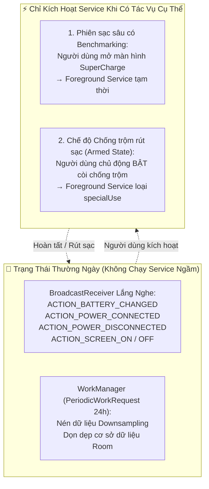

# MA TRẬN TƯƠNG THÍCH ANDROID & HONOR MAGICOS — V2.1
> **Dự án:** TP Honor Battery & Performance Optimizer (`vn.tphonor.optimizer`)  
> **Phiên bản tài liệu:** V2.1 (Technical Correction Release)  
> **Cấu hình SDK:** `minSdk = 26` (Android 8.0) · `compileSdk = 36` (Android 16) · `targetSdk = 36` (Android 16)

---

## 1. CẤU HÌNH SDK & PHÂN TẦNG NỀN TẢNG

```text
minSdkVersion     = 26  (Android 8.0 Oreo - Hỗ trợ các thiết bị Honor từ năm 2017 trở lên)
targetSdkVersion  = 36  (Android 16 Baklava - Tuân thủ chính sách bảo mật và kiến trúc mới nhất)
compileSdkVersion = 36  (Android 16 Baklava - Biên dịch đầy đủ các API và Jetpack Compose 1.8+)
```

### Yêu cầu kỹ thuật khi Target SDK 36 (Android 16):
1. **Tuân thủ phân loại Foreground Service (FGS):** Không được khai báo FGS bừa bãi. Tuyệt đối không dùng `dataSync` cho việc giám sát pin nền vĩnh viễn (Android 15+ áp dụng timeout 6 giờ đối với `dataSync`).
2. **Quyền Full-Screen Intent:** Trên Android 14+ (API 34+), tính năng còi báo động chống trộm khi màn hình khóa bắt buộc phải khai báo quyền `USE_FULL_SCREEN_INTENT`.
3. **16KB Page Size Alignment:** Cấu hình native library (nếu có thư viện C/C++) phải tương thích với kiến trúc bộ nhớ trang 16KB của Android 15/16.
4. **Bảo vệ Broadcast Receiver:** Mọi dynamic receiver phải gắn cờ `RECEIVER_NOT_EXPORTED` hoặc `RECEIVER_EXPORTED` rõ ràng.

---

## 2. MA TRẬN TƯƠNG THÍCH THEO PHIÊN BẢN ANDROID (API 26 ĐẾN API 36)

| Phiên bản Android | API Level | MagicOS tương ứng | Các API Khả dụng & Đổi mới | Giới hạn kỹ thuật & Giải pháp thích ứng |
|---|:---:|---|---|---|
| **Android 8.0 / 8.1** (Oreo) | 26, 27 | MagicOS 2.x / EMUI 8 | `BatteryManager.CURRENT_NOW`, `VOLTAGE`, `TEMPERATURE`, Notification Channels | Áp dụng giới hạn chạy nền nghiêm ngặt. Ứng dụng chuyển sang cơ chế nhận Broadcast hệ thống, không duy trì service chạy nền liên tục. |
| **Android 9** (Pie) | 28 | MagicOS 3.x / EMUI 9 | `UsageStatsManager.getAppStandbyBucket()`, `FOREGROUND_SERVICE` | Khóa `/proc/stat` và `/proc/net`. Hạn chế Reflection vào `PowerProfile`. Fallback: Tra cứu database cấu hình pin model máy. |
| **Android 10** (Q) | 29 | MagicOS 4.x / EMUI 10 | `PowerManager.OnThermalStatusChangedListener` | Giới hạn quyền truy cập bộ nhớ Scoped Storage. Cảm biến nhiệt trạng thái hệ thống bắt đầu khả dụng. |
| **Android 11** (R) | 30 | MagicOS 5.x / 6.x | `PowerManager.getThermalHeadroom(forecastSeconds)` | Bắt buộc khai báo Package Visibility `<queries>` trong Manifest để kiểm tra các package trong danh mục debloat. |
| **Android 12 / 12L** (S) | 31, 32 | MagicOS 6.x / 7.0 | `AlarmManager.canScheduleExactAlarms()` | Không thể khởi chạy Foreground Service trực tiếp từ background. Cần kiểm tra quyền trước khi đặt lịch báo thức chính xác. |
| **Android 13** (Tiramisu) | 33 | MagicOS 7.1 / 7.2 | Quyền runtime `POST_NOTIFICATIONS`, `RECEIVER_NOT_EXPORTED` | Mọi thông báo đều bị chặn cho đến khi người dùng cấp quyền `POST_NOTIFICATIONS`. Bắt buộc xin quyền theo ngữ cảnh. |
| **Android 14** (UpsideDownCake) | 34 | MagicOS 8.0 | `BATTERY_PROPERTY_CYCLE_COUNT`, `USE_FULL_SCREEN_INTENT`, bắt buộc loại FGS cụ thể | `dataSync` bị giám sát nghiêm ngặt. Phân hệ giám sát chuyển sang hoàn toàn **Event-Driven + WorkManager**. Báo chu kỳ sạc phần cứng xuất hiện nhưng tùy thuộc OEM. |
| **Android 15** (VanillaIceCream) | 35 | MagicOS 9.0 | 16KB Page Size, `dataSync` FGS có timeout 6 giờ | Cấm triệt để việc dùng `dataSync` FGS chạy ngầm dài hạn. Tính năng Chống trộm sử dụng loại `specialUse`. |
| **Android 16** (Baklava) | 36 | MagicOS 10.x | Nâng cấp API Quản lý Sức khỏe Pin, tăng cường phân cấp quyền bảo mật | Tuân thủ chính sách quản lý nền và bảo mật dữ liệu phần cứng mới nhất. |

---

## 3. RÀ SOÁT KIẾN TRÚC FOREGROUND SERVICE (LOẠI BỎ DATASYNC DÀI HẠN)

### 3.1. Vấn đề cốt lõi của Android 14+ và Android 15/16
Google Play Console và Android OS Framework từ API 34+ siết chặt việc sử dụng `foregroundServiceType="dataSync"`:
* **Timeout 6 giờ:** Nếu một `dataSync` FGS chạy liên tục quá 6 giờ mà không có tương tác người dùng, hệ thống sẽ ném `ForegroundServiceTimeoutException` và buộc dừng app!
* **Vi phạm chính sách:** Sử dụng `dataSync` cho việc giám sát pin nền vĩnh viễn sẽ bị Google Play từ chối phê duyệt.

### 3.2. Kiến trúc Chạy Nền Không Cần FGS Vĩnh Viễn (Event-Driven Architecture)



* **Loại FGS được sử dụng:** Khi người dùng bật tính năng Chống trộm, sử dụng `foregroundServiceType="specialUse"` kèm thẻ khai báo nghiệp vụ trong `AndroidManifest.xml`:
  ```xml
  <service
      android:name=".core.monitoring.AntiTheftMonitorService"
      android:foregroundServiceType="specialUse"
      android:exported="false">
      <property
          android:name="android.app.PROPERTY_SPECIAL_USE_FGS_SUBTYPE"
          android:value="anti_theft_power_disconnect_protection" />
  </service>
  ```

---

## 4. TƯƠNG THÍCH HONOR MAGICOS: BẢN NỘI ĐỊA (CHINA) VÀ QUỐC TẾ (GLOBAL)

### 4.1. Sự Phân Tách Từ Huawei (`com.huawei.*`) Sang Honor (`com.hihonor.*`)
Từ MagicOS 7.0 trở đi (khi Honor hoạt động hoàn toàn độc lập với Huawei), hệ thống package nội bộ đã trải qua quá trình chuyển đổi:
* Trên các máy MagicOS cũ (MagicOS 4 - 6): Vẫn còn tồn tại các service gốc Huawei như `com.huawei.systemmanager`.
* Trên các máy MagicOS mới (MagicOS 7, 8, 9, 10): Đã chuyển sang `com.hihonor.systemmanager`, `com.hihonor.powergenie`.
* **Cảnh báo lỗi Runtime:** Nếu mã nguồn hardcode một ComponentName duy nhất (ví dụ `com.huawei.systemmanager...`), ứng dụng sẽ bị crash ngay lập tức với lỗi `ActivityNotFoundException` trên các máy Honor đời mới!

### 4.2. Mẫu Khám Phá Intent Đa Tầng (Multi-Intent Discovery Pattern)
Để đảm bảo ứng dụng mở đúng trang cài đặt Quản lý Pin và Tự Khởi Chạy (Auto-Launch) trên mọi máy Honor, áp dụng thuật toán thử lần lượt:

```kotlin
fun openHonorBatteryManager(context: Context): Boolean {
    val candidates = listOf(
        // 1. Honor MagicOS 8 / 9 / 10 hiện đại
        Intent().setComponent(ComponentName("com.hihonor.systemmanager", "com.hihonor.systemmanager.startupmgr.ui.StartupNormalAppListActivity")),
        Intent().setComponent(ComponentName("com.hihonor.systemmanager", "com.hihonor.systemmanager.power.ui.HwPowerManagerActivity")),
        // 2. Honor MagicOS 7 chuyển tiếp
        Intent().setComponent(ComponentName("com.huawei.systemmanager", "com.huawei.systemmanager.startupmgr.ui.StartupNormalAppListActivity")),
        Intent().setComponent(ComponentName("com.huawei.systemmanager", "com.huawei.systemmanager.optimize.process.ProtectActivity")),
        // 3. Fallback chuẩn Android AOSP
        Intent(Settings.ACTION_IGNORE_BATTERY_OPTIMIZATION_SETTINGS),
        Intent(Settings.ACTION_APPLICATION_DETAILS_SETTINGS, Uri.parse("package:${context.packageName}"))
    )

    for (intent in candidates) {
        try {
            intent.addFlags(Intent.FLAG_ACTIVITY_NEW_TASK)
            context.startActivity(intent)
            return true
        } catch (_: Exception) {
            // Tiếp tục thử intent kế tiếp trong danh sách
        }
    }
    return false
}
```
*(Ghi chú: Danh sách Component cụ thể được đánh dấu `[REQUIRES DEVICE-LEVEL VERIFICATION]` trên thiết bị thực tế).*

---

## 5. ĐỒNG BỘ DANH MỤC QUYỀN HẠN TOÀN DIỆN (SYNCHRONIZED PERMISSIONS)

Toàn bộ quyền hạn sử dụng trong ứng dụng được đồng bộ 100% giữa các tài liệu kỹ thuật:

| Quyền hạn | Cấp độ bảo vệ | API Level | Mục đích kỹ thuật thực tế | Phương án Fallback khi bị từ chối |
|---|---|:---:|---|---|
| `POST_NOTIFICATIONS` | Runtime | 33+ | Gửi cảnh báo ngưỡng sạc 80%, cảnh báo quá nhiệt và còi chống trộm | Ứng dụng chỉ hiển thị trạng thái trên màn hình, không thể báo động nền. |
| `PACKAGE_USAGE_STATS` | Special App Access | 21+ | Đọc thời gian sử dụng foreground để xếp hạng mức độ hoạt động ứng dụng | Không hiển thị thời gian dùng của app, chỉ hiển thị danh mục Debloat tĩnh. |
| `FOREGROUND_SERVICE` | Normal | 28+ | Duy trì dịch vụ tạm thời trong phiên sạc sâu hoặc chế độ Chống trộm | Không ghi nhận được biểu đồ sạc chi tiết khi màn hình tắt. |
| `FOREGROUND_SERVICE_SPECIAL_USE` | Normal | 34+ | Khai báo loại FGS hợp lệ trên Android 14+ cho tính năng Chống trộm | Bắt buộc khai báo để tránh crash trên Android 14/15/16. |
| `USE_FULL_SCREEN_INTENT` | Normal / Special | 34+ | Hiển thị giao diện tắt còi báo động khẩn cấp khi màn hình đang khóa | Chỉ phát âm thanh và hiển thị notification thông thường. |
| `SCHEDULE_EXACT_ALARM` | Normal / Special | 31+ | Đặt lịch kiểm tra sạc qua đêm chính xác trước giờ thức dậy | Chuyển sang `WorkManager` không chính xác tuyệt đối (dao động 5-10 phút). |
| `VIBRATE` | Normal | 1+ | Rung phản hồi khi pin đạt 80% hoặc khi còi chống trộm kích hoạt | Chỉ phát âm thanh, không có phản hồi xúc giác. |
| `WAKE_LOCK` | Normal | 1+ | Giữ CPU thức tạm thời (tối đa 60s) trong lúc phát chuông còi báo động | Âm thanh có thể bị ngắt khi máy chuyển sang Deep Sleep. |
| **GỠ BỎ** `INTERNET` | Bị loại bỏ | N/A | Thực thi chính sách Zero-Network Policy 100% Offline | Hệ điều hành chặn toàn bộ kết nối mạng ở cấp kernel. |
| **GỠ BỎ** `CAMERA` | Bị loại bỏ | N/A | Thực thi chính sách Zero-Camera Policy, không có chấm xanh | Không có quyền truy cập camera. |
