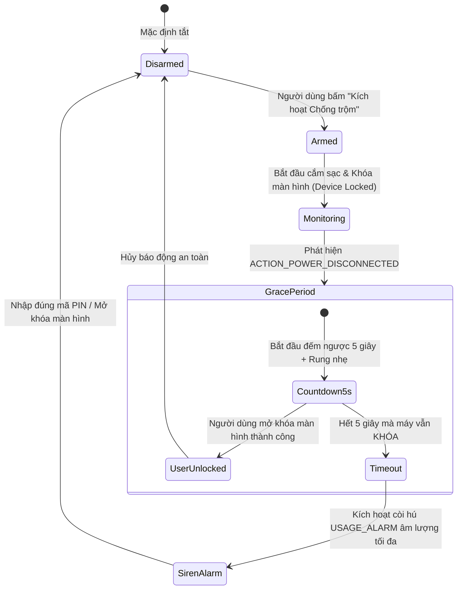

# KIẾN TRÚC PHẦN MỀM & THIẾT KẾ HỆ THỐNG (SOFTWARE ARCHITECTURE) — V2.1
> **Dự án:** TP Honor Battery & Performance Optimizer (`vn.tphonor.optimizer`)  
> **Phiên bản kiến trúc:** V2.1 (Technical Correction Release)  
> **Mô hình kiến trúc:** Clean Architecture + Unidirectional Data Flow (UDF) + Event-Driven Core  
> **Cấu hình SDK:** `minSdk = 26` · `compileSdk = 36` · `targetSdk = 36`

---

## 1. NGUYÊN TẮC THIẾT KẾ & ĐỔI MỚI KỸ THUẬT V2.1

1. **Kiến trúc Không-Polling, Hướng-Sự-Kiện (Zero-Polling Event-Driven):**
   * **Loại bỏ hoàn toàn Foreground Service chạy ngầm dài hạn:** Không sử dụng `dataSync` FGS chạy liên tục 24/7 gây hao pin và vi phạm chính sách timeout 6 giờ của Android 15/16.
   * **Cơ chế thu thập:** Sử dụng các `BroadcastReceiver` tĩnh và động để đón nhận sự kiện thay đổi trạng thái từ OS: `ACTION_BATTERY_CHANGED`, `ACTION_POWER_CONNECTED`, `ACTION_POWER_DISCONNECTED`, `ACTION_SCREEN_ON`, `ACTION_SCREEN_OFF`.
   * **Xử lý nền định kỳ:** Dùng `WorkManager` (PeriodicWorkRequest 24 giờ) để nén dữ liệu Downsampling và tổng kết ngày.
2. **Tách biệt Đo lường Năng lượng và Danh mục Tư vấn:**
   * Module đo lường năng lượng chỉ xử lý dữ liệu thực tế quan sát được từ `UsageStatsManager` và `BatteryManager`.
   * Module `DebloatCatalog` hoạt động như một cơ sở tri thức tư vấn tĩnh, độc lập, không tham gia vào công thức tính toán độ hao pin của app.
3. **Mô hình Thuật toán Không Hệ Số Giả Định (Zero Arbitrary Coefficients):**
   * Loại bỏ toàn bộ các công thức nhân hệ số tùy ý chưa được kiểm chứng ($+0.3, +0.1, 40, 30, 30$).
   * Sử dụng các phương pháp thống kê toán học chuẩn tắc: Lọc trung bình trượt hàm mũ (EMA), Tích phân hình thang (Trapezoidal Rule) và Hồi quy tuyến tính có trọng số thực nghiệm.

---

## 2. SƠ ĐỒ KIẾN TRÚC TỔNG THỂ (SYSTEM ARCHITECTURE DIAGRAM)

```mermaid
flowchart TD
    subgraph PresentationLayer ["🎨 Lớp Giao Diện (Presentation Layer - Jetpack Compose)"]
        DASH_UI["DashboardScreen"]
        CHG_UI["SuperChargeScreen"]
        HLT_UI["BatteryHealthScreen"]
        APP_UI["AppActivityScreen"]
        NIGHT_UI["NightChargeScreen"]
        SET_UI["SettingsScreen"]
        VM["MVI ViewModels\n(StateFlow<UiState>, UiEvent)"]
        THEME["MagicTheme (Porcelain Light / OLED Dark)"]
    end

    subgraph DomainLayer ["🧠 Lớp Nghiệp Vụ (Domain Layer - Pure Kotlin)"]
        UC_BATTERY["GetBatteryStateUseCase"]
        UC_POWER["CalculateBatteryPowerUseCase"]
        UC_PREDICT["PredictBatteryLifeUseCase"]
        UC_HEALTH["EstimateBatteryHealthUseCase"]
        UC_ACTIVITY["AnalyzeAppActivityUseCase"]
        MODELS["Domain Models\n(BatterySnapshot, ChargingSession, AppActivityProfile)"]
    end

    subgraph DataLayer ["💾 Lớp Dữ Liệu (Data Layer - Room & DataStore)"]
        REPO_BATTERY["BatteryRepositoryImpl"]
        REPO_USAGE["AppUsageRepositoryImpl"]
        REPO_SETTINGS["SettingsRepositoryImpl"]
        ROOM_DB["Room Database\n(Snapshots, Sessions, HourlyAggregations, DailySummaries)"]
        DATASTORE["Preferences DataStore\n(Theme, Thresholds, AntiTheftSettings)"]
    end

    subgraph CoreHardwareLayer ["📡 Lớp Phần Cứng & Hệ Thống (Core Hardware & Sensors)"]
        BATTERY_READER["BatteryMetricsCollector\n(BatteryManager API 21+)"]
        THERMAL_MONITOR["ThermalSentinel\n(PowerManager Thermal API 29+)"]
        SCREEN_MONITOR["ScreenStateMonitor\n(ACTION_SCREEN_ON/OFF)"]
        USAGE_TRACKER["UsageStatsTracker\n(UsageStatsManager API 21+)"]
        ALARM_HELPER["AlarmClockHelper\n(AlarmManager.getNextAlarmClock)"]
        ANTI_THEFT_MGR["AntiTheftController\n(Keyguard + USAGE_ALARM Audio)"]
    end

    subgraph AdvancedLayer ["🟣 Lớp Nâng Cao (Advanced Mode - Shizuku / Shell)"]
        SHIZUKU_CTRL["ShizukuController\n(IPC Binder to Shell UID 2000)"]
        PACKAGE_EXEC["PackageActionExecutor\n(am force-stop với User Confirmation)"]
    end

    %% Presentation to Domain
    DASH_UI --> VM
    CHG_UI --> VM
    HLT_UI --> VM
    APP_UI --> VM
    NIGHT_UI --> VM
    SET_UI --> VM
    VM --> UC_BATTERY
    VM --> UC_POWER
    VM --> UC_PREDICT
    VM --> UC_HEALTH
    VM --> UC_ACTIVITY

    %% Domain to Data
    UC_BATTERY --> REPO_BATTERY
    UC_POWER --> REPO_BATTERY
    UC_PREDICT --> REPO_BATTERY
    UC_HEALTH --> REPO_BATTERY
    UC_ACTIVITY --> REPO_USAGE

    %% Data to Core and Storage
    REPO_BATTERY --> ROOM_DB
    REPO_BATTERY --> BATTERY_READER
    REPO_BATTERY --> THERMAL_MONITOR
    REPO_BATTERY --> SCREEN_MONITOR
    REPO_SETTINGS --> DATASTORE
    REPO_USAGE --> USAGE_TRACKER
    REPO_USAGE -.-> SHIZUKU_CTRL
    SHIZUKU_CTRL -.-> PACKAGE_EXEC
```

---

## 3. THUẬT TOÁN & MÔ HÌNH TOÁN HỌC ĐÃ SỬA CHỮA (V2.1)

### 3.1. Thuật toán Coulomb Counter Tích phân Hình thang (Trapezoidal Rule)
Để tính tổng điện tích nạp vào ($Q_{in}$ tính bằng $mAh$) trong một khoảng thời gian sạc từ $t_0$ đến $t_n$:
* Gọi $I_k$ ($mA$) là dòng điện tức thời đo được tại thời điểm $t_k$ ($ms$).
* Thay vì công thức hình chữ nhật sai số lớn, áp dụng quy tắc hình thang:
  $$Q_{in} = \sum_{k=0}^{n-1} \left( \frac{I_k + I_{k+1}}{2} \right) \times \left( \frac{t_{k+1} - t_k}{3,600,000} \right) \quad (mAh)$$
  * *Hệ số chia $3,600,000$ chuyển đổi từ $mA \times ms$ sang $mA \times h$ ($mAh$)*.
* **Xử lý tải tự tiêu thụ (System Self-Consumption):**
  * Trong lúc sạc, nếu màn hình sáng hoặc CPU hoạt động nặng, dòng điện từ củ sạc bị phân nhánh: $I_{in} = I_{bat} + I_{system}$.
  * Dòng điện đọc được từ `CURRENT_NOW` chỉ là $I_{bat}$ nạp vào cell pin. Để ước tính dung lượng sạc đầy chuẩn xác nhất, thuật toán chỉ công nhận các phiên sạc có tỷ lệ sáng màn hình $< 10\%$.

### 3.2. Tiêu chí Đánh giá Sức khỏe Pin (Battery Health Criteria)
* **Dung lượng sạc đầy ước tính từng phiên ($Q_{full\_est}$):**
  $$Q_{full\_est} = \frac{Q_{in}}{\text{Level}_{end} - \text{Level}_{start}} \times 100 \quad (mAh)$$
* **Bộ lọc điều kiện hợp lệ khắt khe:**
  1. $\text{Level}_{start} \le 15\%$ và $\text{Level}_{end} \ge 90\%$ (đảm bảo dải đo $\Delta \text{Level} \ge 75\%$, giảm thiểu sai số ngoại suy).
  2. Nhiệt độ pin ổn định trong khoảng $15^\circ C \le T \le 40^\circ C$.
  3. Phiên sạc không bị ngắt quãng rút cáp giữa chừng.
* **Loại trừ ngoại lai (Outlier Rejection):** Khi tích lũy $\ge 5$ phiên hợp lệ, áp dụng dải phân vị IQR (Interquartile Range) để loại bỏ các phiên lệch quá $\pm 15\%$ so với trung vị (Median).
* **Độ chai pin (Health %):**
  $$\text{Health} = \frac{\text{TrimmedMean}(Q_{full\_est})}{Q_{design}} \times 100\% \quad (\pm \text{Sai số } 5\% - 8\%)$$

### 3.3. Mô hình Dự đoán Thời lượng Pin (Context-Aware Empirical Predictor)
Loại bỏ hoàn toàn các hệ số nhân tùy ý. Mô hình chia làm 2 giai đoạn thực nghiệm:
1. **Phân đoạn Tốc độ Tiêu thụ (Segmented Discharge Rates):**
   * Tính toán độc lập tốc độ xả khi màn hình sáng $R_{on}$ (%/h) và tốc độ xả khi màn hình tắt $R_{off}$ (%/h) dựa trên các mẫu dữ liệu thực tế trong 24 giờ gần nhất:
     $$R_{on} = \frac{\Delta \text{Level}_{on}}{\Delta T_{on}} \times 3600 \times 1000, \quad R_{off} = \frac{\Delta \text{Level}_{off}}{\Delta T_{off}} \times 3600 \times 1000$$
2. **Dự đoán Thích ứng theo Ngữ cảnh Hiện tại:**
   * Nếu người dùng đang sử dụng máy (Screen ON): Dự đoán dựa trên trung bình trượt EMA của $R_{on}$.
   * Nếu máy đang tắt màn hình (Screen OFF): Dự đoán dựa trên $R_{off}$.
   * Dự đoán hỗn hợp tổng thể:
     $$\overline{R} = w_{on} \cdot R_{on} + (1 - w_{on}) \cdot R_{off}$$
     *(với $w_{on}$ là tỷ lệ thời gian sáng màn hình trung bình của người dùng trong ngày).*
   * **Hiển thị:** Bắt buộc hiển thị thời gian dự kiến cạn pin kèm khoảng dao động tin cậy (ví dụ: *"22:30 - 23:10 tối nay"*), không cam kết chính xác tuyệt đối từng phút.

### 3.4. Chỉ số Hoạt động Tiềm ẩn của Ứng dụng (App Activity Index)
* Thay thế khái niệm "Drain Score" bằng **App Activity Index (Chỉ số Mức độ Hoạt động)** để phản ánh trung thực khả năng của `UsageStatsManager`:
  $$\text{ActivityIndex} = \frac{T_{foreground\_app}}{T_{total\_screen\_on}} \times 100$$
* Cung cấp thông tin trực quan cho người dùng: *"Ứng dụng X chiếm Y% tổng thời gian sáng màn hình trong ngày"*.
* Danh mục ứng dụng rác nội địa Honor (Baidu, Honor Mall, v.v.) được hiển thị dưới dạng một nhãn thông tin phụ (Badge: *"Dịch vụ nội địa cài sẵn"*), **hoàn toàn không cộng điểm phạt trừu tượng** vào chỉ số đo lường.

---

## 4. QUY TRÌNH HOẠT ĐỘNG CỦA TÍNH NĂNG CHỐNG TRỘM RÚT SẠC (ANTI-THEFT STATE MACHINE)

* **Cơ chế âm thanh:** Sử dụng `MediaPlayer` gắn thuộc tính `AudioAttributes.USAGE_ALARM` kết hợp `FLAG_AUDIOTRACK_NO_SYSTEM_MUTING` để phát còi hú ngay cả khi điện thoại đang ở chế độ Rung hoặc Im lặng (Silent Mode).
* **Giao diện khẩn cấp:** Khai báo quyền `USE_FULL_SCREEN_INTENT` để bật giao diện nhập mật khẩu tắt còi ngay trên màn hình khóa.

---

## 5. RANH GIỚI BẢO MẬT SHIZUKU (ADVANCED MODE BOUNDARY)

* **Quyền hạn thực tế:** Shizuku cung cấp quyền thực thi dưới danh nghĩa tiến trình `shell` (UID 2000), **không phải Root (UID 0)**.
* **Các lệnh được phép:**
  * `am force-stop <package>`: Đóng băng ứng dụng bên thứ ba (yêu cầu hộp thoại xác nhận từ người dùng).
  * `dumpsys batterystats --charged`: Đọc thống kê chi tiết phần cứng của hệ thống.
* **Các giới hạn tuyệt đối:**
  * Không thể tắt các tiến trình lõi hệ điều hành (`system_server`, `com.android.systemui`).
  * Không thể can thiệp mạch sạc phần cứng.
  * Mọi thao tác đều được ghi nhật ký cục bộ (Local Audit Log) để người dùng kiểm tra.
