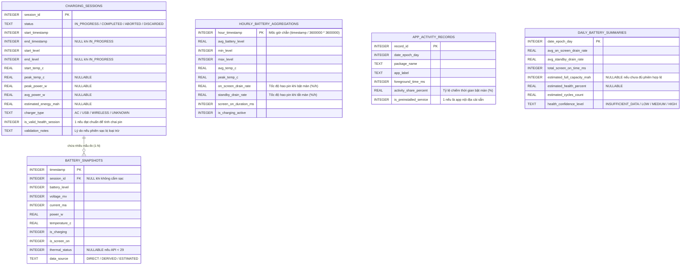

# THIẾT KẾ CƠ SỞ DỮ LIỆU & LƯU TRỮ CHUỖI THỜI GIAN (DATABASE DESIGN) — V2.1
> **Dự án:** TP Honor Battery & Performance Optimizer (`vn.tphonor.optimizer`)  
> **Phiên bản thiết kế:** V2.1 (Technical Correction Release)  
> **Công nghệ lưu trữ:** Android Room Database (SQLite) + Jetpack Preferences DataStore  
> **Phiên bản DB:** `version = 1`

---

## 1. NGUYÊN TẮC THIẾT KẾ & SỬA ĐỔI KỸ THUẬT V2.1

Trong bản V2.1, lược đồ cơ sở dữ liệu được hoàn thiện để khắc phục toàn bộ các thiếu sót của bản phác thảo trước:
1. **Quan hệ Khóa Ngoại Chính Thức (Foreign Key):** Bảng `battery_snapshots` được bổ sung cột `session_id` tham chiếu trực tiếp đến `charging_sessions(session_id)` với hành vi `ON DELETE SET NULL`.
2. **Xử lý Dữ liệu Không Khả Dụng (Nullable Columns):** Các trường phụ thuộc phần cứng (như `thermal_status`, `peak_power_w`) được chuyển thành `NULL` thay vì ép buộc `NOT NULL`, phản ánh trung thực trường hợp thiết bị không hỗ trợ.
3. **Quản lý Vòng đời Phiên sạc (Session Lifecycle Status):** Bảng `charging_sessions` bổ sung cột `status` (`IN_PROGRESS`, `COMPLETED`, `ABORTED`, `DISCARDED`) để tách biệt phiên sạc đang diễn ra và phiên sạc bị hủy bỏ.
4. **Bổ sung Bảng Tổng hợp Theo Giờ (Hourly Aggregations):** Lưu trữ dữ liệu nén sau 24 giờ để vẽ biểu đồ 7 ngày mà không cần quét hàng chục nghìn mẫu đo thô.
5. **Ghi nhận Nguồn gốc Dữ liệu (Data Provenance):** Đánh dấu cờ dữ liệu là `DIRECT`, `DERIVED` hay `ESTIMATED`.

---

## 2. SƠ ĐỒ THỰC THỂ QUAN HỆ (ENTITY RELATIONSHIP DIAGRAM)



---

## 3. LƯỢC ĐỒ SQL CHI TIẾT (ROOM DATABASE SCHEMA)

### 3.1. Bảng `charging_sessions` (Lịch sử các phiên sạc)

```sql
CREATE TABLE IF NOT EXISTS `charging_sessions` (
    `session_id` INTEGER PRIMARY KEY AUTOINCREMENT NOT NULL,
    `status` TEXT NOT NULL,                     -- "IN_PROGRESS", "COMPLETED", "ABORTED", "DISCARDED"
    `start_timestamp` INTEGER NOT NULL,         -- Unix Epoch Milliseconds lúc cắm sạc
    `end_timestamp` INTEGER,                    -- Unix Epoch Milliseconds lúc rút sạc (NULL khi đang sạc)
    `start_level` INTEGER NOT NULL,             -- % pin lúc cắm (0 - 100)
    `end_level` INTEGER,                        -- % pin lúc rút (NULL khi đang sạc)
    `start_temp_c` REAL NOT NULL,               -- Nhiệt độ pin lúc bắt đầu (°C)
    `peak_temp_c` REAL,                         -- Nhiệt độ cao nhất trong phiên (°C)
    `peak_power_w` REAL,                        -- Công suất đỉnh phía pin (W)
    `avg_power_w` REAL,                         -- Công suất trung bình (W)
    `estimated_energy_mah` REAL,                -- Điện tích nạp vào theo tích phân hình thang (mAh)
    `charger_type` TEXT NOT NULL,               -- "AC", "USB", "WIRELESS", "UNKNOWN"
    `is_valid_health_session` INTEGER NOT NULL, -- 1: Đạt chuẩn tính chai pin (bắt đầu <=15%, kết thúc >=90%, nhiệt độ <40°C)
    `validation_notes` TEXT                     -- Ghi chú lý do nếu không đạt chuẩn (ví dụ: "Screen ON > 10%", "Start level > 15%")
);

CREATE INDEX IF NOT EXISTS `index_charging_sessions_start_time` ON `charging_sessions` (`start_timestamp` DESC);
CREATE INDEX IF NOT EXISTS `index_charging_sessions_status` ON `charging_sessions` (`status`);
```

---

### 3.2. Bảng `battery_snapshots` (Dữ liệu chuỗi thời gian)

```sql
CREATE TABLE IF NOT EXISTS `battery_snapshots` (
    `timestamp` INTEGER NOT NULL,               -- Unix Epoch Milliseconds (Khóa chính)
    `session_id` INTEGER,                       -- Khóa ngoại tham chiếu charging_sessions (NULL khi xả pin)
    `battery_level` INTEGER NOT NULL,           -- Mức pin 0 - 100
    `voltage_mv` INTEGER NOT NULL,              -- Điện áp cell pin (mV)
    `current_ma` INTEGER NOT NULL,              -- Dòng điện tức thời (mA, âm khi xả, dương khi sạc)
    `power_w` REAL NOT NULL,                    -- Công suất phía pin (W) = (voltage_mv * current_ma) / 1,000,000
    `temperature_c` REAL NOT NULL,              -- Nhiệt độ pin (°C)
    `is_charging` INTEGER NOT NULL,             -- 1: Đang sạc, 0: Đang xả
    `is_screen_on` INTEGER NOT NULL,            -- 1: Màn hình bật, 0: Màn hình tắt
    `thermal_status` INTEGER,                   -- Enum ThermalStatus (NULL nếu Android < 10)
    `data_source` TEXT NOT NULL,                -- "DIRECT", "DERIVED", "ESTIMATED"
    PRIMARY KEY(`timestamp`),
    FOREIGN KEY(`session_id`) REFERENCES `charging_sessions`(`session_id`) ON DELETE SET NULL
);

CREATE INDEX IF NOT EXISTS `index_snapshots_timestamp` ON `battery_snapshots` (`timestamp` DESC);
CREATE INDEX IF NOT EXISTS `index_snapshots_session` ON `battery_snapshots` (`session_id`);
```

---

### 3.3. Bảng `hourly_battery_aggregations` (Dữ liệu nén theo giờ)

```sql
CREATE TABLE IF NOT EXISTS `hourly_battery_aggregations` (
    `hour_timestamp` INTEGER PRIMARY KEY NOT NULL, -- Mốc giờ chẵn Unix Epoch Milliseconds
    `avg_battery_level` REAL NOT NULL,          -- Mức pin trung bình trong giờ
    `min_level` INTEGER NOT NULL,               -- Mức pin thấp nhất
    `max_level` INTEGER NOT NULL,               -- Mức pin cao nhất
    `avg_temp_c` REAL NOT NULL,                 -- Nhiệt độ trung bình trong giờ (°C)
    `peak_temp_c` REAL NOT NULL,                -- Nhiệt độ cao nhất trong giờ (°C)
    `on_screen_drain_rate` REAL,                -- Tốc độ hao pin khi bật màn hình (%/h, NULL nếu không sáng màn hình)
    `standby_drain_rate` REAL,                  -- Tốc độ hao pin khi tắt màn hình (%/h, NULL nếu không tắt màn hình)
    `screen_on_duration_ms` INTEGER NOT NULL,   -- Tổng thời gian sáng màn hình trong giờ (ms)
    `is_charging_active` INTEGER NOT NULL       -- 1 nếu trong giờ có cắm sạc
);

CREATE INDEX IF NOT EXISTS `index_hourly_timestamp` ON `hourly_battery_aggregations` (`hour_timestamp` DESC);
```

---

### 3.4. Bảng `app_activity_records` (Hồ sơ mức độ hoạt động ứng dụng)

```sql
CREATE TABLE IF NOT EXISTS `app_activity_records` (
    `record_id` INTEGER PRIMARY KEY AUTOINCREMENT NOT NULL,
    `date_epoch_day` INTEGER NOT NULL,          -- Ngày Epoch Day (timestamp / 86400000)
    `package_name` TEXT NOT NULL,               -- Tên package
    `app_label` TEXT NOT NULL,                  -- Tên hiển thị ứng dụng
    `foreground_time_ms` INTEGER NOT NULL,      -- Thời gian chạy foreground từ UsageStatsManager (ms)
    `activity_share_percent` REAL NOT NULL,     -- Tỷ lệ % chiếm thời gian bật màn hình trong ngày
    `is_preinstalled_service` INTEGER NOT NULL  -- 1 nếu nằm trong danh mục dịch vụ nội địa cài sẵn (Advisory)
);

CREATE UNIQUE INDEX IF NOT EXISTS `index_app_activity_day_pkg` ON `app_activity_records` (`date_epoch_day`, `package_name`);
```

---

### 3.5. Bảng `daily_battery_summaries` (Tổng kết sức khỏe pin theo ngày)

```sql
CREATE TABLE IF NOT EXISTS `daily_battery_summaries` (
    `date_epoch_day` INTEGER PRIMARY KEY NOT NULL,
    `avg_on_screen_drain_rate` REAL NOT NULL,   -- Tốc độ hao pin trung bình khi bật màn hình (%/h)
    `avg_standby_drain_rate` REAL NOT NULL,     -- Tốc độ hao pin trung bình khi tắt màn hình (%/h)
    `total_screen_on_time_ms` INTEGER NOT NULL, -- Tổng thời gian sáng màn hình trong ngày (ms)
    `estimated_full_capacity_mah` INTEGER,      -- Dung lượng sạc đầy ước tính trong ngày (NULL nếu chưa đủ dữ liệu)
    `estimated_health_percent` REAL,            -- Tỷ lệ sức khỏe pin ước tính (NULL nếu chưa đủ dữ liệu)
    `estimated_cycles_count` REAL NOT NULL,     -- Chu kỳ sạc tích lũy ước tính (Cộng dồn)
    `health_confidence_level` TEXT NOT NULL     -- "INSUFFICIENT_DATA", "LOW", "MEDIUM", "HIGH"
);
```

---

## 4. CẤU HÌNH PREFERENCES DATASTORE

```kotlin
object PreferencesKeys {
    val THEME_MODE = stringPreferencesKey("theme_mode") // "SYSTEM", "LIGHT", "DARK"
    val SMART_CHARGE_THRESHOLD = intPreferencesKey("smart_charge_threshold") // Mặc định 80%
    val IS_SMART_CHARGE_ALARM_ENABLED = booleanPreferencesKey("is_smart_charge_alarm_enabled") // Mặc định true
    val IS_ANTI_THEFT_ARMED = booleanPreferencesKey("is_anti_theft_armed") // Mặc định false
    val IS_OVERNIGHT_SYNC_ALARM_ENABLED = booleanPreferencesKey("is_overnight_sync_alarm_enabled") // Mặc định true
    val HIGH_TEMP_THRESHOLD_C = intPreferencesKey("high_temp_threshold_c") // Mặc định 42°C
    val LOW_BATTERY_THRESHOLD = intPreferencesKey("low_battery_threshold") // Mặc định 20%
    val MANUAL_DESIGN_CAPACITY_MAH = intPreferencesKey("manual_design_capacity_mah") // Mặc định 0 (tự nhận diện)
    val IS_ADVANCED_SHIZUKU_ENABLED = booleanPreferencesKey("is_advanced_shizuku_enabled") // Mặc định false
}
```

---

## 5. CHIẾN LƯỢC DỌN DẸP & NÉN DỮ LIỆU (DATA DOWNSAMPLING & PRUNING WORKER)

Thực thi định kỳ mỗi 24 giờ bằng `WorkManager`:
1. **Nén dữ liệu:** Đọc các mẫu đo trong bảng `battery_snapshots` của 24 giờ trước $\rightarrow$ Tính toán chỉ số đại diện $\rightarrow$ Ghi vào bảng `hourly_battery_aggregations`.
2. **Xóa mẫu thô:** Xóa các bản ghi `battery_snapshots` cũ hơn 24 giờ (chỉ giữ lại những snapshot gắn với `charging_sessions` hợp lệ).
3. **Giới hạn số phiên sạc:** Giữ tối đa 100 phiên sạc gần nhất trong `charging_sessions`.
4. **Giữ kích thước tệp DB:** Đảm bảo toàn bộ SQLite Database luôn dao động từ **2.5 MB đến 7.0 MB**, hoàn toàn không gây phình bộ nhớ.
