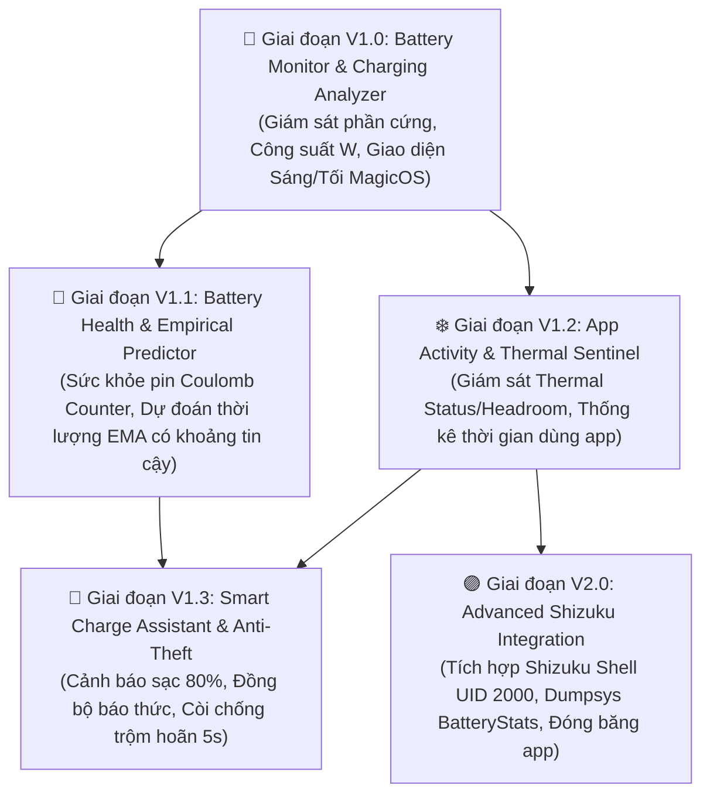

# LỘ TRÌNH TRIỂN KHAI PHÁT TRIỂN (IMPLEMENTATION ROADMAP) — V2.1
> **Dự án:** TP Honor Battery & Performance Optimizer (`vn.tphonor.optimizer`)  
> **Phiên bản tài liệu:** V2.1 (Technical Correction Release)  
> **Cấu hình SDK:** `minSdk = 26` · `compileSdk = 36` · `targetSdk = 36`  
> **Nguyên tắc cốt lõi:** Nghiệm thu khép kín từng giai đoạn · Tiêu chí nghiệm thu bám sát khả năng thực tế của Android AOSP & MagicOS

---

## 1. SƠ ĐỒ TIẾN ĐỘ & PHỤ THUỘC KỸ THUẬT

---

## 2. KẾ HOẠCH CHI TIẾT TỪNG PHIÊN BẢN & TIÊU CHÍ NGHIỆM THU ĐÃ ĐỒNG BỘ

---

### 🚀 PHIÊN BẢN V1.0: BATTERY MONITOR & CHARGING ANALYZER
> **Trọng tâm:** Xây dựng nền tảng ứng dụng hoàn chỉnh, hệ thống giao diện chuẩn Honor MagicOS (đầy đủ cả 2 Theme Sáng Porcelain và Tối OLED) và thu thập thông số pin/sạc thời gian thực từ API Android công khai (No Mock).

#### Các hạng mục phát triển:
1. **Khởi tạo kiến trúc dự án:**
   * Cấu hình Gradle (`minSdk = 26`, `compileSdk = 36`, `targetSdk = 36`), Jetpack Compose BOM, Material 3, Room Database, DataStore, Coroutines.
   * Cấu hình `OptimizerApplication` và hệ thống Kênh thông báo (`NotificationChannels`).
   * Gỡ bỏ hoàn toàn quyền `INTERNET` và `CAMERA` trong `AndroidManifest.xml`.
2. **Hệ thống Giao diện MagicOS (Design System):**
   * Hoàn thiện Palette màu: `MagicOS Light (Porcelain White #F6F8FB)` và `MagicOS Dark (OLED Deep Slate #0A0D14)`.
   * Linh kiện giao diện: `MagicCard` (bo góc 22dp, micro-border, adaptive shadow), `MagicCapsule` (viên nang động), `BatteryGauge` (vòng tròn mức pin), `WattMeterArc` (cung tròn công suất sạc Canvas), `MagicBottomBar` (thanh điều hướng đáy).
   * Tùy chọn chuyển đổi Theme trong Cài đặt: Theo hệ thống / Sáng / Tối.
3. **Phân hệ Giám sát Năng lượng Phần cứng (Hardware Battery Monitoring):**
   * `BatteryMetricsCollector`: Đọc dòng điện `CURRENT_NOW` ($\mu A \rightarrow mA$), điện áp $U_{bat}$ ($mV$), % pin, nhiệt độ pin từ sticky broadcast `ACTION_BATTERY_CHANGED`.
   * Bộ lọc `BatteryPropertyReader`: Tự động nhận diện và chuẩn hóa dấu dòng điện (Polarity Auto-Correction) dựa trên `EXTRA_STATUS`.
   * Tính toán công suất nạp phía cell pin: $P_{bat} = U_{bat} \times I_{bat}$ ($W$) (Gắn nhãn rõ ràng: *"Công suất nạp vào cell pin"*).
4. **Phân hệ Phân tích Sạc Nhanh (SuperCharge Analyzer):**
   * Lắng nghe sự kiện cắm/rút sạc (`ACTION_POWER_CONNECTED` / `DISCONNECTED`).
   * Phân loại mức công suất thực tế: *Sạc Tiêu Chuẩn (<10W), Sạc Nhanh (10-25W), Sạc Siêu Tốc Phía Pin (>25W)*.
   * Quản lý phiên sạc `ChargingSessionManager`: Khởi tạo phiên với trạng thái `IN_PROGRESS`, ghi nhận công suất đỉnh, nhiệt độ đỉnh, cập nhật `COMPLETED` khi rút cáp.
   * Vẽ biểu đồ đường cong sạc thời gian thực ($P, U, I, T$) bằng Canvas Compose với tần suất thích ứng (5s khi biến thiên, 30s khi ổn định).

#### Tiêu chí nghiệm thu thực tế (Acceptance Criteria):
* [ ] Giao diện hiển thị sắc nét, tương phản hoàn hảo ở cả 2 Theme Sáng và Tối; không có hiện tượng chữ trắng chìm trên nền sáng.
* [ ] Cắm sạc $\rightarrow$ Hiển thị chính xác dòng điện mA, điện áp V và công suất nạp W thực tế của pin.
* [ ] Rút sạc $\rightarrow$ Dòng điện hiển thị trạng thái xả (âm) và công suất tiêu thụ của máy.
* [ ] Biểu đồ sạc Canvas phản hồi mượt mà, không bị vẽ lại từ đầu hay crash khi xoay màn hình.
* [ ] Kiểm tra bằng Android Studio Profiler: Mức tiêu thụ CPU ở trạng thái nghỉ xả pin xấp xỉ 0%.

---

### 🧠 PHIÊN BẢN V1.1: BATTERY HEALTH & EMPIRICAL PREDICTOR
> **Trọng tâm:** Ước tính độ chai pin bằng tích phân hình thang Coulomb Counter và mô hình thực nghiệm dự đoán thời gian cạn pin có khoảng tin cậy.

#### Các hạng mục phát triển:
1. **Phân hệ Sức khỏe Pin (Battery Health Intelligence):**
   * Đọc dung lượng thiết kế `PowerProfile` (tra cứu database model Honor nội bộ nếu Reflection bị chặn).
   * Thuật toán tích phân hình thang Coulomb Counter:
     $$Q_{in} = \sum \left(\frac{I_k + I_{k+1}}{2}\right) \times \frac{\Delta t_k}{3,600,000} \quad (mAh)$$
   * Bộ lọc điều kiện hợp lệ khắt khe: Phiên sạc bắt đầu $\le 15\%$, kết thúc $\ge 90\%$, tỷ lệ sáng màn hình $< 10\%$, nhiệt độ $15-40^\circ C$.
   * Tích lũy tối thiểu 5 phiên hợp lệ, loại trừ ngoại lai bằng IQR để tính dung lượng sạc đầy trung bình $\overline{Q_{full\_est}}$ và tỷ lệ chai pin ($\text{Health} = \frac{\overline{Q_{full\_est}}}{Q_{design}} \times 100\%$).
   * Đếm chu kỳ sạc ước tính tích lũy (Estimated Cycles) trong cơ sở dữ liệu Room.
2. **Mô hình Dự đoán Thời lượng Pin (Context-Aware Empirical Predictor):**
   * Tính toán độc lập tốc độ xả khi màn hình sáng $R_{on}$ (%/h) và khi màn hình tắt $R_{off}$ (%/h) dựa trên mẫu đo 24 giờ gần nhất.
   * Áp dụng bộ lọc trung bình trượt hàm mũ (EMA) để bắt kịp xu hướng sử dụng gần nhất.
   * Đầu ra dự đoán: Thời gian dự kiến cạn pin hiển thị kèm khoảng tin cậy (ví dụ: *"22:30 - 23:10 tối nay"*).
   * Khi dữ liệu đo $< 2$ giờ: Hiển thị nhãn *"Đang thu thập dữ liệu"*, minh bạch, không phỏng đoán.
3. **Màn hình Sức khỏe Pin (BatteryHealthScreen):**
   * Hiển thị bảng chỉ số sức khỏe, lịch sử suy giảm dung lượng và mức độ tin cậy của dữ liệu (`INSUFFICIENT_DATA`, `LOW`, `MEDIUM`, `HIGH`).

#### Tiêu chí nghiệm thu thực tế (Acceptance Criteria):
* [ ] Hiển thị đúng dung lượng thiết kế đối với các dòng máy Honor có trong cơ sở dữ liệu tra cứu.
* [ ] Khi chưa đủ 5 phiên sạc hợp lệ: Hiển thị trạng thái *"Đang tích lũy dữ liệu phiên sạc (X/5)"*, không tự tiện hiển thị % chai pin phỏng đoán.
* [ ] Dự đoán thời gian cạn pin luôn đi kèm khoảng tin cậy rõ ràng; tốc độ xả phản ánh đúng sự khác biệt giữa On-Screen và Standby.

---

### ❄️ PHIÊN BẢN V1.2: APP ACTIVITY & THERMAL SENTINEL
> **Trọng tâm:** Giám sát trạng thái nhiệt hệ thống qua Android Thermal API và thống kê mức độ hoạt động của các ứng dụng chiếm dụng màn hình.

#### Các hạng mục phát triển:
1. **Phân hệ Giám sát Nhiệt độ Hệ thống (Thermal Sentinel):**
   * Đăng ký lắng nghe `PowerManager.OnThermalStatusChangedListener` (API 29+) để theo dõi trạng thái nghẽn nhiệt (`NONE` đến `CRITICAL`).
   * Đọc khoảng dự trữ nhiệt `PowerManager.getThermalHeadroom(forecastSeconds)` (API 30+).
   * Cảnh báo người dùng khi nhiệt độ pin vượt ngưỡng cài đặt (mặc định $42^\circ C$).
2. **Phân hệ Phân tích Hoạt động Ứng dụng (App Activity Analyzer):**
   * Xin quyền `PACKAGE_USAGE_STATS` qua hộp thoại giải thích mục đích minh bạch.
   * Đọc thời gian chạy foreground của từng ứng dụng từ `UsageStatsManager.queryUsageStats()`.
   * Tính toán chỉ số mức độ hoạt động: $\text{ActivityIndex} = \frac{T_{foreground}}{T_{total\_screen\_on}} \times 100\%$.
   * Tích hợp danh mục tư vấn tĩnh **Honor Pre-installed Services Catalog** để đánh dấu các dịch vụ nội địa Trung Quốc cài sẵn (Baidu, Honor Mall, v.v.).
   * Nút bấm 1-chạm: Mở `ACTION_APPLICATION_DETAILS_SETTINGS` để người dùng thực hiện Force Stop thủ công.

#### Tiêu chí nghiệm thu thực tế (Acceptance Criteria):
* [ ] Thermal Status và Thermal Headroom phản hồi chính xác theo thời gian thực trên Android 10+.
* [ ] Bảng xếp hạng ứng dụng sắp xếp chính xác theo thời gian chạy foreground thực tế từ hệ thống.
* [ ] Bấm vào ứng dụng trong danh sách mở đúng trang App Info trong Cài đặt hệ thống.

---

### 🔔 PHIÊN BẢN V1.3: SMART CHARGE ASSISTANT & ANTI-THEFT
> **Trọng tâm:** Trợ lý bảo vệ pin ở ngưỡng 80%, đồng bộ giờ báo thức thức dậy và còi báo động chống trộm rút sạc có thời gian hoãn an toàn.

#### Các hạng mục phát triển:
1. **Trợ lý Cảnh báo Sạc 80% (Smart Charge Alarm):**
   * Đón broadcast `ACTION_BATTERY_CHANGED`. Khi pin đạt ngưỡng thiết lập (mặc định 80%), kích hoạt thông báo và chuông báo nhẹ nhàng để người dùng rút sạc.
   * Cung cấp nút mở trực tiếp cài đặt *"Bảo vệ sạc thông minh"* của MagicOS thông qua mẫu Intent đa tầng.
2. **Đồng bộ Giờ Thức Dậy (Overnight Charge Sync):**
   * Đọc mốc báo thức gần nhất qua `AlarmManager.getNextAlarmClock()`.
   * Đưa ra gợi ý thời điểm cắm sạc lý tưởng nhất trước khi thức dậy.
3. **Cảnh báo Chống Trộm Rút Sạc (Anti-Theft Charging Alert):**
   * Người dùng kích hoạt chế độ Chống trộm $\rightarrow$ Bật `ForegroundService` loại `specialUse`.
   * Khi rút sạc (`ACTION_POWER_DISCONNECTED`) trong lúc màn hình đang khóa (`KeyguardManager.isDeviceLocked()`):
     * Kích hoạt thời gian hoãn an toàn 5 giây (Grace Period) kèm rung nhẹ.
     * Nếu người dùng mở khóa màn hình thành công trong 5 giây $\rightarrow$ Hủy báo động an toàn.
     * Nếu sau 5 giây máy vẫn bị khóa $\rightarrow$ Phát còi hú âm lượng lớn qua `AudioAttributes.USAGE_ALARM` và kích hoạt giao diện nhập mã PIN khẩn cấp qua `USE_FULL_SCREEN_INTENT`.

#### Tiêu chí nghiệm thu thực tế (Acceptance Criteria):
* [ ] Khi sạc chạm đúng 80%, chuông thông báo reo chuẩn xác.
* [ ] Rút sạc khi màn hình khóa: Còi không hú ngay mà đếm ngược 5 giây; mở khóa máy còi tự hủy, không gây phiền phức khi rút sạc thông thường.
* [ ] Nếu không mở khóa sau 5 giây: Còi hú vang kể cả khi điện thoại đang ở chế độ Rung hoặc Im lặng.

---

### 🟣 PHIÊN BẢN V2.0: ADVANCED SHIZUKU INTEGRATION
> **Trọng tâm:** Tích hợp nâng cao dành cho người dùng chuyên sâu thông qua Shizuku Framework.

#### Các hạng mục phát triển:
1. **Tích hợp Shizuku Framework (Shell UID 2000):**
   * Tự động phát hiện dịch vụ Shizuku, kiểm tra trạng thái quyền và kết nối Binder an toàn.
2. **Quản lý Package Nâng Cao:**
   * Cho phép thực thi lệnh đóng băng ứng dụng trực tiếp: `am force-stop <package>` qua Shizuku (bắt buộc có hộp thoại xác nhận từ người dùng).
   * Đọc thống kê chi tiết phần cứng qua lệnh shell `dumpsys batterystats --charged`.
3. **Nhật ký Thao tác & Kiểm toán An toàn:**
   * Ghi log toàn bộ các lệnh shell đã thực thi vào tệp nhật ký cục bộ để người dùng kiểm soát minh bạch.

#### Tiêu chí nghiệm thu thực tế (Acceptance Criteria):
* [ ] Shizuku Controller hoạt động ổn định trên MagicOS 7, 8, 9 và 10.
* [ ] Mọi thao tác qua Shizuku đều có xác nhận chủ động, không bao giờ tự động can thiệp ngầm.
