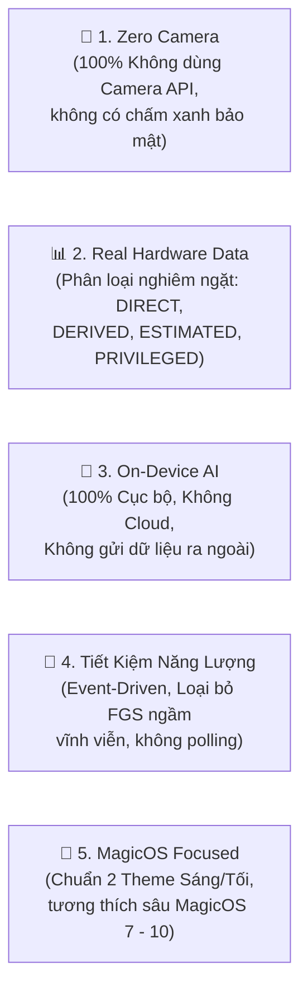

# 🔋 KẾ HOẠCH KỸ THUẬT TỔNG THỂ: TP HONOR OPTIMIZER — PHIÊN BẢN V2.1
> **Dự án:** TP Honor Battery & Performance Optimizer  
> **Tên ứng dụng:** TP Honor Optimizer  
> **Package Name:** `vn.tphonor.optimizer`  
> **Cấu hình SDK:** `minSdk = 26` (Android 8.0) · `compileSdk = 36` (Android 16) · `targetSdk = 36` (Android 16)  
> **Nền tảng ưu tiên:** HONOR MagicOS 7.x, 8.x, 9.x, 10.x+  
> **Ngôn ngữ & Giao diện:** Kotlin 2.x · Jetpack Compose · Material 3 · Room Database · Preferences DataStore  
> **Phiên bản tài liệu:** V2.1 (Technical Correction Release)

---

## 1. TỔNG QUAN DỰ ÁN & BẢN CHẤT KỸ THUẬT V2.1

TP Honor Optimizer là bộ công cụ phân tích, tối ưu năng lượng và giám sát hiệu năng được thiết kế chuyên biệt cho hệ sinh thái **HONOR MagicOS** tại Việt Nam.

Phiên bản **V2.1** là kết quả của đợt kiểm toán kỹ thuật toàn diện, sửa chữa triệt để mọi giả định phi thực tế từ các bản phác thảo trước, nâng cấp targetSdk lên **API 36 (Android 16)**, và thiết lập một chuẩn mực kỹ thuật trung thực, khả thi 100% dựa trên Android AOSP và MagicOS thực tế.

---

## 2. 5 NGUYÊN TẮC CỐT LÕI (CORE PRINCIPLES)

1. **Zero-Camera Policy:** Tuyệt đối không khai báo hay sử dụng bất kỳ API camera nào. Không bao giờ kích hoạt chấm xanh bảo mật (Privacy Indicator) trên Android 12+.
2. **Trung thực về Nguồn Dữ liệu (Data Honesty):** Mọi chỉ số đều được phân loại: `DIRECT`, `DERIVED`, `ESTIMATED`, `PRIVILEGED`, `UNAVAILABLE`. Tuyệt đối không hiển thị dữ liệu ước tính dưới danh nghĩa đo trực tiếp.
3. **AI Cục bộ Hoàn toàn (100% Offline):** Mọi mô hình dự đoán và thuật toán chạy trực tiếp trên thiết bị bằng Kotlin/Math thuần túy. Gỡ bỏ quyền `INTERNET` trong `AndroidManifest.xml`.
4. **Không Polling Nền (Zero-Polling Event-Driven):** Không duy trì Foreground Service dài hạn gây hao pin. Dữ liệu được thu thập qua các BroadcastReceiver hệ thống và nén định kỳ bởi `WorkManager`.
5. **Giao diện Chuẩn Honor MagicOS:** Hỗ trợ song song cả **Giao diện Sáng (Porcelain Light `#F6F8FB`)** và **Giao diện Tối (OLED Deep Slate `#0A0D14`)** với 100% VectorDrawable XML.

---

## 3. CÁC MÔ HÌNH TOÁN HỌC & THUẬT TOÁN KỸ THUẬT ĐÃ SỬA CHỮA

### 3.1. Đo lường Công suất Sạc Phía Cell Pin ($P_{bat}$)
* **Điện áp cell pin ($U_{bat}$):** Đọc từ `BatteryManager.EXTRA_VOLTAGE` ($mV \rightarrow V$).
* **Dòng điện tức thời ($I_{bat}$):** Đọc từ `BatteryManager.getIntProperty(BATTERY_PROPERTY_CURRENT_NOW)` ($\mu A \rightarrow mA$).
* **Thuật toán tự động chuẩn hóa dấu dòng điện (Polarity Auto-Correction):**
  $$\text{Sign} = \begin{cases} +1 & \text{khi STATUS == CHARGING và } I_{bat} > 0 \\ -1 & \text{khi STATUS == CHARGING nhưng Kernel trả về } I_{bat} < 0 \text{ (Tự đảo dấu)} \\ -1 & \text{khi STATUS == DISCHARGING} \end{cases}$$
* **Công suất nạp vào cell pin:**
  $$P_{bat} = U_{bat} \times I_{bat} \quad (W)$$
  * *Lưu ý kỹ thuật:* Đây là công suất phía sau biến đổi PMIC nạp vào hóa học cell pin, không phải công suất đầu vào cổng USB-C ($P_{bus}$). Ứng dụng phân loại công suất: *Sạc Tiêu Chuẩn (<10W), Sạc Nhanh (10-25W), Sạc Siêu Tốc Phía Pin (>25W)*.

---

### 3.2. Thuật toán Tích phân Hình thang Ước tính Sức khỏe Pin (Coulomb Counter)
Để tính tổng điện tích nạp vào ($Q_{in}$ tính bằng $mAh$) trong một phiên sạc:
$$Q_{in} = \sum_{k=0}^{n-1} \left( \frac{I_k + I_{k+1}}{2} \right) \times \left( \frac{t_{k+1} - t_k}{3,600,000} \right) \quad (mAh)$$
* **Dung lượng sạc đầy ước tính từng phiên ($Q_{full\_est}$):**
  $$Q_{full\_est} = \frac{Q_{in}}{\text{Level}_{end} - \text{Level}_{start}} \times 100 \quad (mAh)$$
* **Điều kiện phiên sạc hợp lệ khắt khe:**
  1. Bắt đầu $\le 15\%$ và kết thúc $\ge 90\%$ (dải đo $\Delta \text{Level} \ge 75\%$).
  2. Màn hình chủ yếu tắt ($T_{screen\_on} / T_{total} < 10\%$) để triệt tiêu tải tự tiêu thụ của hệ thống.
  3. Nhiệt độ pin ổn định trong khoảng $15^\circ C \le T \le 40^\circ C$.
* **Độ chai pin (Health %):** Tích lũy tối thiểu 5 phiên hợp lệ, loại trừ ngoại lai bằng dải phân vị IQR:
  $$\text{Health} = \frac{\text{TrimmedMean}(Q_{full\_est})}{Q_{design}} \times 100\% \quad (\pm \text{Sai số thực nghiệm } 5\% - 8\%)$$

---

### 3.3. Mô hình Thực nghiệm Dự đoán Thời lượng Pin (Context-Aware Empirical Predictor)
Loại bỏ hoàn toàn các hệ số nhân tùy ý chưa được kiểm chứng. Mô hình hoạt động theo 2 pha thực nghiệm:
1. **Phân đoạn Tốc độ Tiêu thụ:** Tính toán độc lập tốc độ xả khi màn hình sáng $R_{on}$ (%/h) và khi màn hình tắt $R_{off}$ (%/h) dựa trên mẫu đo 24 giờ gần nhất:
   $$R_{on} = \frac{\Delta \text{Level}_{on}}{\Delta T_{on}} \times 3600 \times 1000, \quad R_{off} = \frac{\Delta \text{Level}_{off}}{\Delta T_{off}} \times 3600 \times 1000$$
2. **Dự đoán Thích ứng:**
   * Áp dụng bộ lọc trung bình trượt hàm mũ (EMA):
     $$R_{EMA}(t) = 0.3 \cdot R_{instant}(t) + 0.7 \cdot R_{EMA}(t-1)$$
   * Thời gian dự kiến cạn pin luôn đi kèm khoảng tin cậy: $[T_{pred} - \Delta t, T_{pred} + \Delta t]$ với $\Delta t = \pm 15 - 30$ phút.
   * Khi dữ liệu đo $< 2$ giờ: Hiển thị nhãn *"Đang thu thập dữ liệu"*, không phỏng đoán số liệu.

---

### 3.4. Chỉ số Mức độ Hoạt động của Ứng dụng (App Activity Index)
* Thay thế khái niệm "Drain Score" bằng **Chỉ số Mức độ Hoạt động**:
  $$\text{ActivityIndex} = \frac{T_{foreground\_app}}{T_{total\_screen\_on}} \times 100\%$$
* Tách biệt hoàn toàn danh mục ứng dụng rác nội địa Honor (Baidu, Honor Mall, v.v.): Hiển thị dưới dạng nhãn tư vấn phụ (Badge: *"Dịch vụ nội địa cài sẵn"*), hoàn toàn không cộng điểm phạt trừu tượng vào chỉ số đo lường.

---

### 3.5. Trạng thái Hoạt động của Còi Báo Động Chống Trộm (Anti-Theft State Machine)
* Kích hoạt `ForegroundService` loại `specialUse` (với subtype `anti_theft_power_disconnect_protection`).
* Khi phát hiện rút sạc (`ACTION_POWER_DISCONNECTED`) lúc màn hình đang khóa:
  * Đếm ngược thời gian hoãn an toàn 5 giây (Grace Period) kèm rung nhẹ.
  * Nếu người dùng mở khóa màn hình thành công trong 5 giây $\rightarrow$ Hủy báo động an toàn.
  * Nếu hết 5 giây máy vẫn bị khóa $\rightarrow$ Phát còi hú âm lượng tối đa qua `AudioAttributes.USAGE_ALARM` và kích hoạt màn hình nhập mật khẩu tắt còi bằng `USE_FULL_SCREEN_INTENT`.

---

## 4. BỘ TÀI LIỆU KỸ THUẬT V2.1 ĐÍNH KÈM

Toàn bộ 6 tài liệu kỹ thuật chi tiết đã được cập nhật đồng bộ tại thư mục [docs/v2.1/](file:///home/dcs/Desktop/Honor-Optimization-Toolkit/docs/v2.1/):

1. 📊 [FEATURE_FEASIBILITY.md](file:///home/dcs/Desktop/Honor-Optimization-Toolkit/docs/v2.1/FEATURE_FEASIBILITY.md) — Ma trận kiểm toán tính khả thi chi tiết của 32 tính năng; phân loại DIRECT, DERIVED, ESTIMATED, PRIVILEGED, UNAVAILABLE.
2. 📱 [ANDROID_COMPATIBILITY.md](file:///home/dcs/Desktop/Honor-Optimization-Toolkit/docs/v2.1/ANDROID_COMPATIBILITY.md) — Ma trận tương thích Android từ API 26 đến 36; kiến trúc loại bỏ FGS dài hạn; mẫu khám phá Intent MagicOS đa tầng.
3. 🏗️ [ARCHITECTURE.md](file:///home/dcs/Desktop/Honor-Optimization-Toolkit/docs/v2.1/ARCHITECTURE.md) — Kiến trúc Clean Architecture, luồng dữ liệu UDF, cấu trúc package chi tiết, quy tắc hình thang Coulomb Counter.
4. 💾 [DATABASE_DESIGN.md](file:///home/dcs/Desktop/Honor-Optimization-Toolkit/docs/v2.1/DATABASE_DESIGN.md) — Thiết kế Room Database (bổ sung khóa ngoại `session_id`, nullable fields, bảng `hourly_battery_aggregations`, data provenance).
5. 🔒 [PRIVACY_AND_PERMISSIONS.md](file:///home/dcs/Desktop/Honor-Optimization-Toolkit/docs/v2.1/PRIVACY_AND_PERMISSIONS.md) — Cam kết Zero-Network, Zero-Camera, đồng bộ quyền hạn 100% với ma trận tương thích.
6. 🚀 [IMPLEMENTATION_ROADMAP.md](file:///home/dcs/Desktop/Honor-Optimization-Toolkit/docs/v2.1/IMPLEMENTATION_ROADMAP.md) — Lộ trình phát triển 5 phiên bản (V1.0 đến V2.0) với tiêu chí nghiệm thu bám sát khả năng thực tế của Android AOSP.

---

## 5. HỆ THỐNG GIAO DIỆN MAGICOS (DESIGN SYSTEM)

* **☀️ Giao diện Sáng (Porcelain Light Theme):** Nền trắng sứ `#F6F8FB`, thẻ trắng tinh `#FFFFFF` bo góc mềm `22.dp`, viền siêu mỏng micro-border `#E2E8F0`, chữ đen than chì Slate `#0F172A`.
* **🌙 Giao diện Tối (OLED Deep Slate Theme):** Nền đen sâu OLED `#0A0D14`, thẻ xám than `#1B212E`, viền xanh Magic Blue `#0A59F7` và Magic Cyan `#00B4D8`, chữ trắng sáng `#FFFFFF`.
* **Thành phần giao diện:** `MagicCapsule` (viên nang động), `BatteryGauge` (vòng tròn mức pin), `WattMeterArc` (cung tròn công suất Canvas), `MagicBottomBar` (thanh điều hướng đáy).
* **100% Android VectorDrawable XML:** Sắc nét ở mọi mật độ điểm ảnh (MDPI đến XXXHDPI).

---

## 6. KẾ HOẠCH BẢO ĐẢM CHẤT LƯỢNG (TESTING & VERIFICATION)

1. **Unit Tests:** Kiểm thử quy tắc tích phân hình thang Coulomb Counter, kiểm thử chuẩn hóa dấu dòng điện `CURRENT_NOW`, kiểm thử mô hình hồi quy EMA và logic IQR loại trừ ngoại lai.
2. **Compatibility Tests:** Kiểm tra cấu hình SDK 26 đến 36; kiểm tra xử lý graceful degradation khi thiếu quyền hoặc phần cứng không hỗ trợ.
3. **MagicOS Real Device Verification:** Kiểm tra trực tiếp trên thiết bị Honor MagicOS thực tế về hành vi nhận diện cắm sạc, âm thanh còi chống trộm và chuyển đổi giao diện Sáng/Tối.
