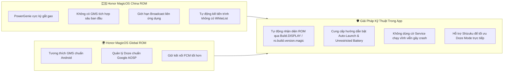

# MA TRẬN TƯƠNG THÍCH ANDROID & HONOR MAGICOS
> **Dự án:** TP Honor Battery & Performance Optimizer (`vn.tphonor.optimizer`)  
> **Phiên bản tài liệu:** V2.0  
> **Cấu hình SDK:** `minSdk = 26` (Android 8.0 Oreo) · `compileSdk = 35` (Android 15) · `targetSdk = 35`

---

## 1. TỔNG QUAN PHÂN TẦNG SDK

| Thuộc tính SDK | Giá trị | Giải thích kiến trúc & Yêu cầu pháp lý/kỹ thuật |
|---|:---:|---|
| **minSdkVersion** | **26** | Đảm bảo hỗ trợ các thiết bị Honor chạy Android 8.0 trở lên. Các tính năng cao cấp sẽ sử dụng cơ chế Feature Detection và kiểm tra `Build.VERSION.SDK_INT` khi kích hoạt. |
| **targetSdkVersion** | **35** | Tuân thủ chính sách mới nhất của Google Play và quy chuẩn bảo mật Android 15 (yêu cầu khai báo cụ thể `foregroundServiceType`, bảo vệ `RECEIVER_NOT_EXPORTED`, quyền truy cập tệp 16KB page alignment). |
| **compileSdkVersion** | **35** | Cho phép biên dịch và sử dụng các API mới nhất của Android 15 và Material 3 Compose 1.3+. |

---

## 2. MA TRẬN TƯƠNG THÍCH THEO PHIÊN BẢN ANDROID (API 26 ĐẾN API 36)

| Phiên bản Android | API Level | MagicOS tương ứng | Các API khả dụng | Các giới hạn & Thay đổi chính sách bắt buộc xử lý |
|---|:---:|---|---|---|
| **Android 8.0 / 8.1** (Oreo) | 26, 27 | MagicOS 2.x / EMUI 8 | `BatteryManager.CURRENT_NOW`, `VOLTAGE`, `TEMPERATURE`, Notification Channels | Bắt đầu áp dụng giới hạn chạy nền nghiêm ngặt (Background Execution Limits). Không thể duy trì service chạy nền vĩnh viễn mà không có Foreground Notification. |
| **Android 9** (Pie) | 28 | MagicOS 3.x / EMUI 9 | `UsageStatsManager.getAppStandbyBucket()`, `FOREGROUND_SERVICE` permission | Khóa hoàn toàn việc truy cập `/proc/net` và hạn chế mạnh các tệp trong `/proc/stat`. Chặn Reflection vào non-SDK interfaces (như `PowerProfile` nếu nằm trong blacklist). |
| **Android 10** (Q) | 29 | MagicOS 4.x / EMUI 10 | `PowerManager.OnThermalStatusChangedListener` | Giới hạn quyền truy cập bộ nhớ dùng chung (Scoped Storage). Hạn chế truy cập định danh phần cứng (`getSerial()`, MAC address). |
| **Android 11** (R) | 30 | MagicOS 5.x / 6.x | `PowerManager.getThermalHeadroom(forecastSeconds)` | Bắt buộc khai báo Package Visibility trong `<queries>` của `AndroidManifest.xml` nếu muốn đọc danh sách ứng dụng đã cài đặt. |
| **Android 12 / 12L** (S) | 31, 32 | MagicOS 6.x / 7.0 | `AlarmManager.canScheduleExactAlarms()` | Không thể khởi chạy Foreground Service trực tiếp từ background trừ một số trường hợp ngoại lệ. Giới hạn `ExactAlarm` cần kiểm tra quyền trước khi đặt lịch. |
| **Android 13** (Tiramisu) | 33 | MagicOS 7.1 / 7.2 | Quyền runtime `POST_NOTIFICATIONS`, `RECEIVER_EXPORTED` flag | Mọi thông báo đều bị chặn cho đến khi người dùng cấp quyền `POST_NOTIFICATIONS`. Mọi dynamic broadcast receiver phải khai báo cờ Exported rõ ràng. |
| **Android 14** (UpsideDownCake) | 34 | MagicOS 8.0 | `BATTERY_PROPERTY_CYCLE_COUNT`, bắt buộc khai báo `foregroundServiceType` | Phải khai báo loại Foreground Service cụ thể (ví dụ `dataSync` hoặc `specialUse`). Hạn chế ngắt quãng các broadcast ngầm không bảo vệ. |
| **Android 15** (VanillaIceCream) | 35 | MagicOS 9.0 | 16KB Page size support, Private Space | `dataSync` foreground service bị giới hạn thời gian chạy tối đa (6 giờ timeout). Phải sử dụng `WorkManager` kết hợp JobScheduler cho các tác vụ định kỳ. |
| **Android 16** (Preview/Kế hoạch) | 36 | MagicOS 10.x | Cải tiến API Quản lý sức khỏe pin | Tiếp tục phân cấp quyền đọc dữ liệu pin theo tiêu chuẩn bảo mật sinh trắc học và chống fingerprinting. |

---

## 3. ĐẶC ĐÙN HỆ ĐIỀU HÀNH HONOR MAGICOS & CÁC LƯU Ý BẢN ĐỊA

### 3.1. Phân biệt MagicOS ROM Nội Địa (China) và Quốc Tế (Global)



### 3.2. Quản trị Tiến trình Ngầm (PowerGenie & App Launch Manager)

Trên các thiết bị HONOR MagicOS, trình quản lý **PowerGenie** (`com.hihonor.powergenie`) can thiệp rất sâu vào vòng đời ứng dụng:
1. **Auto-Launch (Tự khởi chạy):** Mặc định tắt đối với các ứng dụng bên thứ ba.
2. **Secondary Launch (Liên kết khởi chạy):** Bị chặn giữa các ứng dụng không cùng chữ ký.
3. **Run in Background (Chạy nền):** Bị ngắt socket sau khi tắt màn hình 3-5 phút nếu ứng dụng không nằm trong danh sách WhiteList hoặc không có Foreground Service hợp lệ.

**Giải pháp của TP Honor Optimizer:**
- Kiểm tra trạng thái tối ưu hóa pin thông qua `PowerManager.isIgnoringBatteryOptimizations(packageName)`.
- Nếu chưa được cấp quyền, mở trực tiếp trang cài đặt quản lý pin của HONOR:
  ```kotlin
  val intent = Intent().apply {
      component = ComponentName(
          "com.huawei.systemmanager",
          "com.huawei.systemmanager.startupmgr.ui.StartupNormalAppListActivity"
      )
  }
  ```
- Dự phòng fallback sang tiêu chuẩn Android: `Settings.ACTION_REQUEST_IGNORE_BATTERY_OPTIMIZATIONS`.

---

## 4. CHI TIẾT CÁC QUYỀN HẠN RUNTIME & BẢO MẬT THEO CẤP ĐỘ

| Tên quyền | Cấp độ bảo vệ | Mục đích sử dụng | Xử lý khi bị từ chối |
|---|---|---|---|
| `POST_NOTIFICATIONS` | Runtime (API 33+) | Hiển thị cảnh báo sạc 80%, quá nhiệt và thông báo Foreground Service | Ứng dụng vẫn hoạt động nhưng không thể gửi cảnh báo âm thanh/rung khi chạy nền. Hiển thị Banner nhắc nhở trên giao diện. |
| `PACKAGE_USAGE_STATS` | Special App Access | Phân tích thời gian sử dụng các ứng dụng để phát hiện app ngốn pin ngầm | Phân hệ Drainer Analyzer chuyển sang chế độ *"Ước tính hạn chế"* dựa trên các app phổ biến, không hiển thị biểu đồ thời gian chính xác. |
| `FOREGROUND_SERVICE` | Normal (API 28+) | Duy trì giám sát chu kỳ sạc và bảo vệ chống trộm rút sạc | Không có Foreground Service thì các tính năng giám sát sạc chỉ hoạt động khi ứng dụng đang mở trên màn hình. |
| `FOREGROUND_SERVICE_DATA_SYNC` | Normal (API 34+) | Khai báo loại FGS cho tác vụ thu thập chuỗi thời gian pin | Bắt buộc đối với Android 14+ để tránh bị hệ thống ném `SecurityException`. |
| `SCHEDULE_EXACT_ALARM` | Normal / Special | Đặt lịch kiểm tra chu kỳ sạc bù vào rạng sáng | Chuyển sang sử dụng `WorkManager` không chính xác tuyệt đối (dao động 5-10 phút), chấp nhận độ trễ nhỏ. |
| `ACCESS_NOTIFICATION_POLICY` | Special (DND) | Cho phép phát còi hú chống trộm ngay cả khi máy ở chế độ Im lặng | Phát âm thanh theo luồng `STREAM_ALARM` thay vì can thiệp bật/tắt chế độ DND toàn hệ thống. |
| `BATTERY_STATS` | Signature / Privileged | Đọc chi tiết CPU time và wakelock từng ứng dụng | **Không xin trong Manifest**. Chỉ sử dụng khi người dùng kích hoạt Chế độ Nâng cao qua ADB hoặc Shizuku. |

---

## 5. TƯƠNG THÍCH SHIZUKU (ADVANCED MODE)

* **Phiên bản Shizuku tối thiểu hỗ trợ:** API v13+ (Hỗ trợ từ Shizuku v12 trở lên).
* **Kiểm tra Shizuku sẵn sàng:**
  ```kotlin
  fun isShizukuAvailable(): Boolean {
      return try {
          Shizuku.pingBinder() && Shizuku.checkSelfPermission() == PackageManager.PERMISSION_GRANTED
      } catch (e: Exception) {
          false
      }
  }
  ```
* **Các lệnh Shell thực thi an toàn qua Shizuku:**
  * `dumpsys batterystats --charged` (Đọc dữ liệu tiêu thụ chi tiết).
  * `am force-stop <package>` (Đóng băng ứng dụng ngậm pin theo yêu cầu người dùng).
  * `dumpsys power` (Kiểm tra trạng thái các wakelock hệ thống).
* **Nguyên tắc an toàn:** Không bao giờ tự động chạy các lệnh gỡ cài đặt (`pm uninstall`) mà không có sự xác nhận của người dùng. Mọi thao tác phải lưu log hoàn tác.
