# KIẾN TRÚC PHẦN MỀM & THIẾT KẾ HỆ THỐNG (SOFTWARE ARCHITECTURE)
> **Dự án:** TP Honor Battery & Performance Optimizer (`vn.tphonor.optimizer`)  
> **Phiên bản kiến trúc:** V2.0  
> **Mô hình kiến trúc:** Clean Architecture + Unidirectional Data Flow (UDF) + Multi-Module / Layered Package Structure  
> **Công nghệ:** Kotlin 2.x · Jetpack Compose · Material 3 · Room Database · DataStore · Kotlin Coroutines & StateFlow

---

## 1. NGUYÊN TẮC THIẾT KẾ CỐT LÕI

1. **Phân tách trách nhiệm nghiêm ngặt (Separation of Concerns):** Lớp giao diện (Presentation) hoàn toàn không biết về nguồn dữ liệu phần cứng (`BatteryManager`, `sysfs`, v.v.). Mọi tương tác phải thông qua Domain Layer (UseCases).
2. **Luồng dữ liệu một chiều (Unidirectional Data Flow - UDF):** Giao diện phát ra các `Event` (User Intents), ViewModel xử lý và phát ra `UiState` bất biến (Immutable StateFlow).
3. **Thu thập dữ liệu theo sự kiện & Lấy mẫu thích ứng (Event-Driven & Adaptive Sampling):**
   * Không chạy vòng lặp `while(true) delay()` chạy ngầm liên tục gây hao pin.
   * Lắng nghe các Broadcast hệ thống: `ACTION_BATTERY_CHANGED`, `ACTION_POWER_CONNECTED`, `ACTION_POWER_DISCONNECTED`, `ACTION_SCREEN_ON`, `ACTION_SCREEN_OFF`.
   * Khi cắm sạc (Charging Session active): Kích hoạt lấy mẫu thích ứng (5s khi dòng điện biến thiên, 30s khi ổn định).
   * Khi không cắm sạc (Discharging): Chỉ ghi nhận khi có sự thay đổi % pin hoặc sau mỗi 15 phút.
4. **Cô lập chế độ Standard và Advanced (Shizuku):** Module `advanced/` hoạt động như một plugin độc lập. Nếu không có Shizuku/ADB, ứng dụng vẫn vận hành trơn tru ở chế độ Standard Mode.

---

## 2. SƠ ĐỒ KIẾN TRÚC TỔNG THỂ (SYSTEM ARCHITECTURE DIAGRAM)

```mermaid
flowchart TD
    subgraph PresentationLayer ["🎨 Lớp Giao Diện (Presentation Layer - Jetpack Compose)"]
        UI_DASH["DashboardScreen"]
        UI_CHG["SuperChargeScreen"]
        UI_HLT["BatteryHealthScreen"]
        UI_DRN["DrainerScreen"]
        UI_SET["SettingsScreen"]
        VM["MVI ViewModels\n(DashboardViewModel, ChargingViewModel, ...)"]
        THEME["MagicTheme\n(Porcelain Light / OLED Dark)"]
    end

    subgraph DomainLayer ["🧠 Lớp Nghiệp Vụ (Domain Layer - Pure Kotlin)"]
        UC_GET_REALTIME["GetRealtimeBatteryStatsUseCase"]
        UC_CALC_POWER["CalculateChargingPowerUseCase"]
        UC_PREDICT_LIFE["PredictBatteryLifeUseCase"]
        UC_ANALYZE_DRAIN["AnalyzeAppDrainUseCase"]
        UC_ESTIMATE_HEALTH["EstimateBatteryHealthUseCase"]
        MODELS["Domain Models\n(BatterySnapshot, ChargingSession, AppRiskProfile)"]
    end

    subgraph DataLayer ["💾 Lớp Dữ Liệu (Data Layer - Room & DataStore)"]
        REPO_BATTERY["BatteryRepositoryImpl"]
        REPO_USAGE["AppUsageRepositoryImpl"]
        REPO_SETTINGS["SettingsRepositoryImpl"]
        ROOM_DB["Room Database\n(BatteryDao, SessionDao, DailySummaryDao)"]
        DATASTORE["Preferences DataStore\n(Theme, Thresholds, AlarmPreferences)"]
    end

    subgraph CoreHardwareLayer ["📡 Lớp Phần Cứng & Hệ Thống (Core Hardware & Sensors)"]
        BATTERY_COLLECTOR["BatteryMetricsCollector\n(BatteryManager API 21+)"]
        THERMAL_SENTINEL["ThermalSentinel\n(PowerManager Thermal API 29+)"]
        SCREEN_MONITOR["ScreenStateMonitor\n(Brightness & Screen On/Off)"]
        USAGE_TRACKER["UsageStatsTracker\n(UsageStatsManager API 21+)"]
        ALARM_SYNC["AlarmClockSync\n(AlarmManager.getNextAlarmClock)"]
    end

    subgraph AdvancedLayer ["🟣 Lớp Nâng Cao (Advanced Mode - Optional)"]
        SHIZUKU_MGR["ShizukuManager\n(IPermission / Shell Executor)"]
        ADB_SERVICE["AdbShellService\n(Dumpsys parser / am force-stop)"]
    end

    %% presentation to domain
    UI_DASH --> VM
    UI_CHG --> VM
    UI_HLT --> VM
    UI_DRN --> VM
    UI_SET --> VM
    VM --> UC_GET_REALTIME
    VM --> UC_CALC_POWER
    VM --> UC_PREDICT_LIFE
    VM --> UC_ANALYZE_DRAIN
    VM --> UC_ESTIMATE_HEALTH

    %% domain to data
    UC_GET_REALTIME --> REPO_BATTERY
    UC_CALC_POWER --> REPO_BATTERY
    UC_PREDICT_LIFE --> REPO_BATTERY
    UC_ESTIMATE_HEALTH --> REPO_BATTERY
    UC_ANALYZE_DRAIN --> REPO_USAGE

    %% data to storage and core
    REPO_BATTERY --> ROOM_DB
    REPO_BATTERY --> BATTERY_COLLECTOR
    REPO_BATTERY --> THERMAL_SENTINEL
    REPO_BATTERY --> SCREEN_MONITOR
    REPO_SETTINGS --> DATASTORE
    REPO_USAGE --> USAGE_TRACKER
    REPO_USAGE -.-> SHIZUKU_MGR
    SHIZUKU_MGR -.-> ADB_SERVICE
```



---

## 3. CẤU TRÚC GÓI MÃ NGUỒN CHI TIẾT (PACKAGE STRUCTURE)

```text
vn.tphonor.optimizer/
├── OptimizerApplication.kt                 # Khởi tạo App, Hilt DI, kênh Notification
│
├── core/                                   # Các thành phần kết nối trực tiếp với Android Framework
│   ├── hardware/
│   │   ├── BatteryMetricsCollector.kt      # Đọc dòng điện (mA), điện áp (mV), % pin, nhiệt độ
│   │   ├── BatteryPropertyReader.kt        # Xử lý quy ước dấu dòng điện (polarity check)
│   │   └── PowerProfileReader.kt           # Đọc dung lượng thiết kế (Design Capacity) qua Reflection/DB
│   ├── monitoring/
│   │   ├── BatteryBroadcastReceiver.kt     # Đón ACTION_BATTERY_CHANGED, POWER_CONNECTED
│   │   ├── ScreenStateReceiver.kt          # Đón ACTION_SCREEN_ON, ACTION_SCREEN_OFF
│   │   └── BatteryMonitorService.kt        # Foreground Service chạy phiên sạc hoặc cảnh báo chống trộm
│   ├── analytics/
│   │   ├── SuperChargeDetector.kt          # Phân loại chuẩn sạc, lọc nhiễu công suất
│   │   └── ChargingSessionManager.kt       # Quản lý vòng đời phiên sạc (Start -> Peak -> CV -> Full)
│   ├── intelligence/
│   │   ├── AIBatteryPredictor.kt           # Mô hình hồi quy EMA + Poly Regression dự đoán giờ cạn pin
│   │   ├── DrainScoreCalculator.kt         # Thuật toán tính điểm rủi ro ứng dụng ngốn pin
│   │   └── HealthEstimator.kt              # Thuật toán Coulomb Counter ước tính độ chai pin
│   ├── thermal/
│   │   ├── ThermalSentinel.kt              # Lắng nghe OnThermalStatusChangedListener & getThermalHeadroom
│   │   └── ThermalThrottlingAdvisor.kt     # Đề xuất hạ nhiệt khi máy chạm ngưỡng SEVERE
│   ├── permissions/
│   │   ├── PermissionManager.kt            # Quản lý xin quyền POST_NOTIFICATIONS, USAGE_STATS
│   │   └── HonorSettingsNavigator.kt       # Mở trang quản lý pin, tự khởi chạy riêng của Honor
│   └── system/
│       ├── AlarmClockHelper.kt             # Đọc mốc báo thức gần nhất từ AlarmManager
│       └── AntiTheftAlarmController.kt     # Điều khiển còi hú khi rút sạc trái phép
│
├── data/                                   # Lưu trữ và điều phối dữ liệu
│   ├── database/
│   │   ├── OptimizerDatabase.kt            # Room Database chính (version = 1)
│   │   ├── dao/
│   │   │   ├── BatterySnapshotDao.kt       # Lưu trữ chuỗi thời gian pin
│   │   │   ├── ChargingSessionDao.kt       # Lưu trữ lịch sử từng lần sạc
│   │   │   └── AppUsageRecordDao.kt        # Lưu trữ lịch sử tiêu thụ của ứng dụng
│   │   └── entity/
│   │       ├── BatterySnapshotEntity.kt
│   │       ├── ChargingSessionEntity.kt
│   │       └── AppUsageRecordEntity.kt
│   ├── datastore/
│   │   └── PreferencesDataStoreManager.kt  # Lưu trữ Theme, ngưỡng báo sạc 80%, còi chống trộm
│   └── repository/
│       ├── BatteryRepositoryImpl.kt
│       ├── AppUsageRepositoryImpl.kt
│       └── SettingsRepositoryImpl.kt
│
├── domain/                                 # Quy tắc nghiệp vụ độc lập
│   ├── model/
│   │   ├── BatteryRealtimeState.kt         # Trạng thái pin trực tiếp (Level, Voltage, Current, Power, Temp)
│   │   ├── ChargingSession.kt              # Dữ liệu phiên sạc đầy đủ
│   │   ├── PredictionResult.kt             # Kết quả dự đoán (HoursLeft, DepleteAt, Confidence, DrainRate)
│   │   ├── AppRiskProfile.kt               # Hồ sơ đánh giá rủi ro ngốn pin của app (LOW/MED/HIGH)
│   │   └── BatteryHealthInfo.kt            # Dung lượng thiết kế, dung lượng ước tính, % chai
│   ├── repository/
│   │   ├── BatteryRepository.kt
│   │   ├── AppUsageRepository.kt
│   │   └── SettingsRepository.kt
│   └── usecase/
│       ├── GetRealtimeBatteryStateUseCase.kt
│       ├── CalculateChargingPowerUseCase.kt
│       ├── PredictBatteryLifeUseCase.kt
│       ├── AnalyzeAppDrainUseCase.kt
│       ├── EstimateBatteryHealthUseCase.kt
│       └── HandleOvernightChargeProtectionUseCase.kt
│
├── advanced/                               # Module Shizuku / ADB (Tùy chọn, độc lập)
│   ├── shizuku/
│   │   ├── ShizukuController.kt            # Ping binder, xin quyền Shizuku
│   │   └── ShizukuShellExecutor.kt         # Thực thi lệnh shell có kiểm soát
│   └── adb/
│       ├── BatteryStatsDumpParser.kt       # Phân tích cú pháp dumpsys batterystats
│       └── PackageActionExecutor.kt        # Thực hiện am force-stop an toàn
│
└── presentation/                           # Giao diện người dùng Jetpack Compose
    ├── theme/
    │   ├── Color.kt                        # Palette MagicOS (MagicBlue, MagicCyan, Porcelain, OLED Dark)
    │   ├── Theme.kt                        # MagicTheme (cung cấp LocalMagicColors dynamic)
    │   └── Type.kt                         # Typography chuẩn MagicOS
    ├── components/
    │   ├── MagicCard.kt                    # Thẻ bo góc 22dp, micro-border, adaptive shadow
    │   ├── MagicCapsule.kt                 # Viên nang động hiển thị công suất W và nhiệt độ
    │   ├── BatteryGauge.kt                 # Đồng hồ vòng tròn đo % pin
    │   ├── WattMeterArc.kt                 # Cung tròn đo công suất sạc W
    │   └── ThermalHeadroomBar.kt           # Thanh đo khoảng dự trữ nhiệt
    ├── dashboard/
    │   ├── DashboardScreen.kt              # Màn hình chính tổng quan
    │   └── DashboardViewModel.kt
    ├── supercharge/
    │   ├── SuperChargeScreen.kt            # Màn hình đo công suất sạc và đồ thị thời gian thực
    │   └── SuperChargeViewModel.kt
    ├── health/
    │   ├── BatteryHealthScreen.kt          # Màn hình sức khỏe pin và chu kỳ sạc
    │   └── BatteryHealthViewModel.kt
    ├── drainer/
    │   ├── DrainerScreen.kt                # Màn hình phát hiện app ngậm pin và gợi ý đóng băng
    │   └── DrainerViewModel.kt
    ├── nightcharge/
    │   ├── NightChargeScreen.kt            # Màn hình cấu hình sạc đêm và cảnh báo 80%
    │   └── NightChargeViewModel.kt
    ├── settings/
    │   ├── SettingsScreen.kt               # Cài đặt Theme (Sáng/Tối), ngưỡng nhiệt độ, thông tin bản quyền
    │   └── SettingsViewModel.kt
    └── navigation/
        ├── Screen.kt                       # Định nghĩa các Route
        └── AppNavigation.kt                # Scaffold & Bottom Navigation Bar
```

---

## 4. CHIẾN LƯỢC LƯU TRỮ VÀ GIẢM TẢI CƠ SỞ DỮ LIỆU (DATABASE DOWNSAMPLING STRATEGY)

Để đảm bảo ứng dụng không bao giờ chiếm dụng quá **10MB bộ nhớ trong**:
1. **Dữ liệu thô (Raw Snapshots):** Ghi nhận mỗi 1-5 phút khi sạc hoặc khi có biến thiên mức pin. Giữ tối đa **24 giờ**.
2. **Dữ liệu nén (Hourly Aggregations):** Cứ sau 24 giờ, một tác vụ `WorkManager` sẽ tổng hợp các bản ghi trong ngày thành 24 bản ghi đại diện theo giờ (Mức pin trung bình, nhiệt độ cao nhất, tốc độ xả trung bình). Giữ trong **30 ngày**.
3. **Dữ liệu phiên sạc (Charging Sessions):** Chỉ lưu bản tóm tắt phiên sạc (Thời gian bắt đầu, kết thúc, năng lượng nạp, công suất đỉnh, nhiệt độ đỉnh). Giữ tối đa **100 phiên sạc gần nhất**.
4. **Dữ liệu tổng kết ngày (Daily Summaries):** Lưu dung lượng ước tính hàng ngày và chu kỳ sạc tích lũy. Giữ vĩnh viễn (kích thước cực nhỏ, < 500KB cho 3 năm sử dụng).
