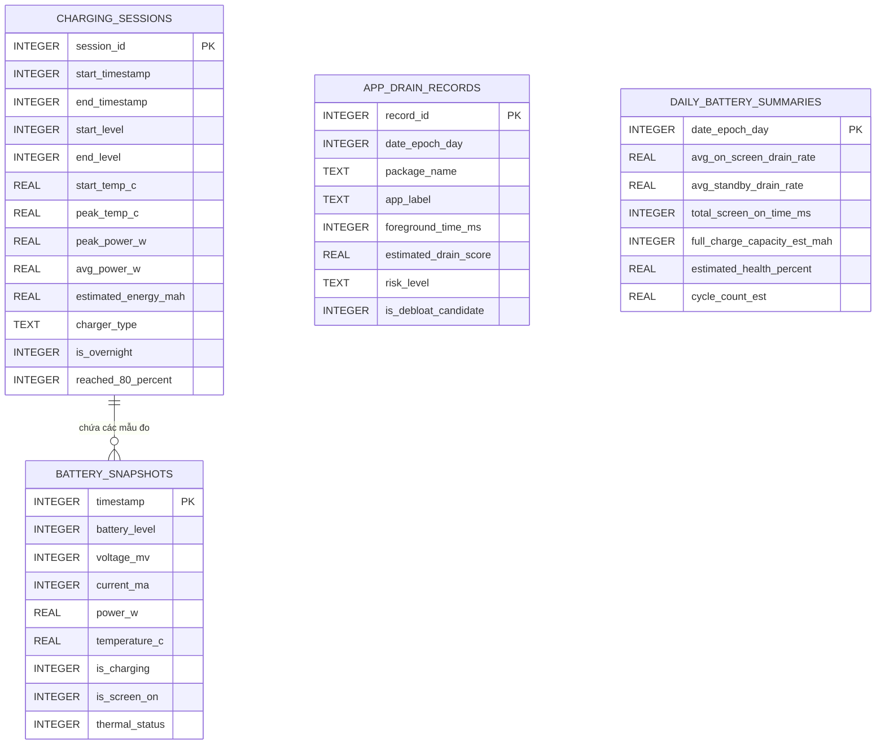

# THIẾT KẾ CƠ SỞ DỮ LIỆU & LƯU TRỮ CHUỖI THỜI GIAN (DATABASE DESIGN)
> **Dự án:** TP Honor Battery & Performance Optimizer (`vn.tphonor.optimizer`)  
> **Phiên bản thiết kế:** V2.0  
> **Công nghệ lưu trữ:** Android Room Database (SQLite) + Jetpack Preferences DataStore  
> **Phiên bản DB:** `version = 1`

---

## 1. MỤC TIÊU LƯU TRỮ VÀ RÀNG BUỘC HIỆU NĂNG

Hệ thống lưu trữ của TP Honor Optimizer phục vụ 3 mục đích nghiệp vụ:
1. **Lưu trữ chuỗi thời gian (Time-Series):** Ghi nhận liên tục các biến thiên dòng điện, điện áp, nhiệt độ để vẽ đồ thị sạc và làm tập dữ liệu huấn luyện cho mô hình hồi quy AI.
2. **Lưu trữ tổng hợp phiên sạc (Charging Sessions):** Đánh giá tốc độ sạc, phân tích sự suy giảm dung lượng (Health Degradation Trend) qua từng phiên sạc.
3. **Cấu hình người dùng (Preferences):** Lưu trữ tùy chọn Theme, ngưỡng cảnh báo sạc 80%, còi chống trộm.

### Ràng buộc hiệu năng:
* **Không làm nghẽn I/O Disk:** Mọi thao tác ghi dữ liệu chuỗi thời gian đều thực hiện bất đồng bộ trong Coroutine IO Dispatcher.
* **Giới hạn dung lượng DB:** Kích thước cơ sở dữ liệu trên máy không vượt quá **10 MB** nhờ cơ chế Downsampling và tự động dọn dẹp (Pruning Policy).

---

## 2. THIẾT KẾ THỰC THỂ ROOM DATABASE (ENTITIES & SCHEMA)



---

### 2.1. Bảng `battery_snapshots` (Dữ liệu chuỗi thời gian chi tiết)

Bảng ghi nhận trạng thái pin theo thời gian thực. Được tối ưu hóa cho truy vấn vẽ đồ thị và phân tích hồi quy.

```sql
CREATE TABLE IF NOT EXISTS `battery_snapshots` (
    `timestamp` INTEGER NOT NULL,          -- Unix Epoch Milliseconds (Khóa chính)
    `battery_level` INTEGER NOT NULL,      -- Mức pin 0 - 100
    `voltage_mv` INTEGER NOT NULL,         -- Điện áp cell pin (mV)
    `current_ma` INTEGER NOT NULL,         -- Dòng điện tức thời (mA, âm khi xả, dương khi nạp)
    `power_w` REAL NOT NULL,               -- Công suất phía pin (W) = (voltage * current) / 1,000,000
    `temperature_c` REAL NOT NULL,         -- Nhiệt độ pin (°C)
    `is_charging` INTEGER NOT NULL,        -- 1 nếu đang cắm sạc, 0 nếu đang xả
    `is_screen_on` INTEGER NOT NULL,       -- 1 nếu màn hình sáng, 0 nếu màn hình tắt
    `thermal_status` INTEGER NOT NULL,     -- Giá trị Enum ThermalStatus từ PowerManager (0 = NONE đến 6 = SHUTDOWN)
    PRIMARY KEY(`timestamp`)
);

CREATE INDEX IF NOT EXISTS `index_battery_snapshots_timestamp` ON `battery_snapshots` (`timestamp` DESC);
CREATE INDEX IF NOT EXISTS `index_battery_snapshots_charging` ON `battery_snapshots` (`is_charging`, `timestamp` DESC);
```

---

### 2.2. Bảng `charging_sessions` (Lịch sử các phiên sạc)

Mỗi lần cắm sạc tạo một phiên sạc mới. Ghi lại từ lúc bắt đầu cắm cáp cho tới khi rút sạc hoặc pin đầy 100%.

```sql
CREATE TABLE IF NOT EXISTS `charging_sessions` (
    `session_id` INTEGER PRIMARY KEY AUTOINCREMENT NOT NULL,
    `start_timestamp` INTEGER NOT NULL,    -- Thời điểm bắt đầu cắm sạc
    `end_timestamp` INTEGER NOT NULL,      -- Thời điểm rút sạc (hoặc hoàn tất)
    `start_level` INTEGER NOT NULL,        -- Mức pin lúc cắm (%)
    `end_level` INTEGER NOT NULL,          -- Mức pin lúc rút (%)
    `start_temp_c` REAL NOT NULL,          -- Nhiệt độ lúc bắt đầu (°C)
    `peak_temp_c` REAL NOT NULL,           -- Nhiệt độ cao nhất trong phiên sạc (°C)
    `peak_power_w` REAL NOT NULL,          -- Công suất sạc đỉnh phía pin (W)
    `avg_power_w` REAL NOT NULL,           -- Công suất sạc trung bình (W)
    `estimated_energy_mah` REAL NOT NULL,  -- Năng lượng nạp vào ước tính (Coulomb integration mAh)
    `charger_type` TEXT NOT NULL,          -- "AC", "USB", "WIRELESS", "UNKNOWN"
    `is_overnight` INTEGER NOT NULL,       -- 1 nếu diễn ra trong khung giờ 22:00 - 06:00
    `reached_80_percent` INTEGER NOT NULL  -- 1 nếu phiên sạc đã chạm mốc bảo vệ 80%
);

CREATE INDEX IF NOT EXISTS `index_charging_sessions_start_time` ON `charging_sessions` (`start_timestamp` DESC);
```

---

### 2.3. Bảng `app_drain_records` (Hồ sơ tiêu thụ pin của ứng dụng theo ngày)

Tổng hợp mức độ sử dụng và điểm rủi ro ngốn pin của các ứng dụng từ `UsageStatsManager`.

```sql
CREATE TABLE IF NOT EXISTS `app_drain_records` (
    `record_id` INTEGER PRIMARY KEY AUTOINCREMENT NOT NULL,
    `date_epoch_day` INTEGER NOT NULL,     -- Ngày thống kê (Epoch Day = timestamp / 86400000)
    `package_name` TEXT NOT NULL,          -- Tên package (vd: com.zing.zalo, com.baidu.swan)
    `app_label` TEXT NOT NULL,             -- Tên hiển thị người dùng (vd: Zalo, Baidu Swan)
    `foreground_time_ms` INTEGER NOT NULL, -- Thời gian chạy foreground trong ngày (ms)
    `estimated_drain_score` REAL NOT NULL, -- Điểm rủi ro ngốn pin (0.0 - 100.0)
    `risk_level` TEXT NOT NULL,            -- "LOW", "MEDIUM", "HIGH"
    `is_debloat_candidate` INTEGER NOT NULL-- 1 nếu nằm trong danh mục app rác nội địa Honor
);

CREATE UNIQUE INDEX IF NOT EXISTS `index_app_drain_day_package` ON `app_drain_records` (`date_epoch_day`, `package_name`);
```

---

### 2.4. Bảng `daily_battery_summaries` (Thống kê tổng hợp hàng ngày)

Lưu trữ các chỉ số vĩ mô phục vụ phân tích xu hướng dài hạn (Degradation Trend) của pin.

```sql
CREATE TABLE IF NOT EXISTS `daily_battery_summaries` (
    `date_epoch_day` INTEGER NOT NULL,     -- Ngày tổng kết (Khóa chính)
    `avg_on_screen_drain_rate` REAL NOT NULL, -- Tốc độ hao pin trung bình khi bật màn hình (%/h)
    `avg_standby_drain_rate` REAL NOT NULL,   -- Tốc độ hao pin trung bình khi tắt màn hình (%/h)
    `total_screen_on_time_ms` INTEGER NOT NULL, -- Tổng thời gian sáng màn hình trong ngày (ms)
    `full_charge_capacity_est_mah` INTEGER NOT NULL, -- Dung lượng sạc đầy ước tính trong ngày (mAh)
    `estimated_health_percent` REAL NOT NULL, -- Sức khỏe pin ước tính (% so với dung lượng thiết kế)
    `cycle_count_est` REAL NOT NULL,       -- Chu kỳ sạc tích lũy ước tính (Cộng dồn)
    PRIMARY KEY(`date_epoch_day`)
);
```

---

## 3. THIẾT KẾ PREFERENCES DATASTORE (SETTINGS SCHEMA)

Toàn bộ cấu hình tùy chọn và tham số người dùng được lưu trữ bằng `androidx.datastore.preferences`:

| Khóa DataStore | Kiểu dữ liệu | Giá trị mặc định | Giải thích ý nghĩa |
|---|:---:|:---:|---|
| `theme_mode` | `String` | `"SYSTEM"` | Chế độ giao diện: `"SYSTEM"`, `"LIGHT"`, `"DARK"` |
| `smart_charge_threshold` | `Int` | `80` | Ngưỡng báo sạc đầy khuyến nghị (70% - 95%) |
| `is_smart_charge_alarm_enabled`| `Boolean` | `true` | Bật/tắt chuông báo khi sạc chạm ngưỡng |
| `is_anti_theft_alarm_enabled` | `Boolean` | `false` | Bật còi hú chống trộm khi rút sạc trái phép |
| `is_overnight_sync_alarm_enabled`| `Boolean` | `true` | Tự động đồng bộ với giờ báo thức thức dậy |
| `high_temp_threshold_c` | `Int` | `42` | Ngưỡng nhiệt độ cảnh báo nóng máy (°C) |
| `low_battery_threshold` | `Int` | `20` | Ngưỡng cảnh báo pin yếu (%) |
| `manual_design_capacity_mah` | `Int` | `0` | Dung lượng thiết kế do người dùng nhập thủ công (nếu hệ thống không có) |
| `is_advanced_shizuku_enabled` | `Boolean` | `false` | Bật tích hợp Shizuku cho tính năng nâng cao |

---

## 4. CHIẾN LƯỢC DỌN DẸP DỮ LIỆU TỰ ĐỘNG (DATA PRUNING WORKER)

Một `CoroutineWorker` chạy định kỳ mỗi 24 giờ thông qua `WorkManager` sẽ thực thi các câu lệnh dọn dẹp:

```kotlin
@Dao
interface DataPruningDao {
    // 1. Xóa các mẫu đo chi tiết cũ hơn 24 giờ (đã được tổng hợp vào daily summary)
    @Query("DELETE FROM battery_snapshots WHERE timestamp < :cutoffTimeMs")
    suspend fun pruneOldSnapshots(cutoffTimeMs: Long): Int

    // 2. Giữ tối đa 100 phiên sạc gần nhất
    @Query("""
        DELETE FROM charging_sessions WHERE session_id NOT IN (
            SELECT session_id FROM charging_sessions ORDER BY start_timestamp DESC LIMIT 100
        )
    """)
    suspend fun pruneOldChargingSessions(): Int

    // 3. Xóa bản ghi app drain cũ hơn 30 ngày
    @Query("DELETE FROM app_drain_records WHERE date_epoch_day < :cutoffEpochDay")
    suspend fun pruneOldAppDrainRecords(cutoffEpochDay: Long): Int
}
```
Chiến lược này đảm bảo kích thước cơ sở dữ liệu luôn giữ ổn định ở mức **3 - 8 MB** trong suốt vòng đời sử dụng ứng dụng.
