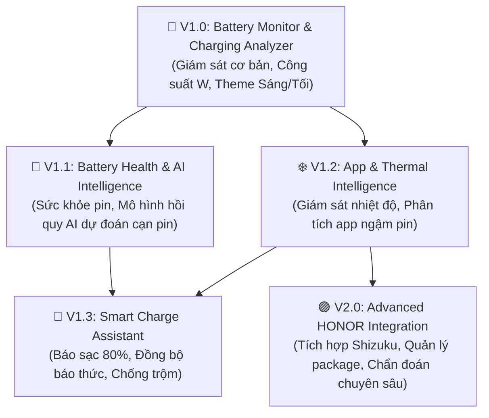

# LỘ TRÌNH TRIỂN KHAI PHÁT TRIỂN (IMPLEMENTATION ROADMAP)
> **Dự án:** TP Honor Battery & Performance Optimizer (`vn.tphonor.optimizer`)  
> **Phiên bản tài liệu:** V2.0  
> **Mục tiêu:** Chia nhỏ dự án thành các mốc phát hành (Milestones) độc lập, có thể nghiệm thu và kiểm thử khép kín từng giai đoạn.

---

## 1. BIỂU ĐỒ PHỤ THUỘC GIỮA CÁC PHIÊN BẢN (VERSION DEPENDENCY GRAPH)

---

## 2. KẾ HOẠCH CHI TIẾT TỪNG PHIÊN BẢN

---

### 🚀 PHIÊN BẢN V1.0: BATTERY MONITOR & CHARGING ANALYZER
> **Mục tiêu:** Xây dựng bộ khung ứng dụng hoàn chỉnh, hệ thống giao diện chuẩn MagicOS (Sáng & Tối) và phân hệ đo đạc thông số pin/sạc thời gian thực từ phần cứng thật (No Mock).

#### Các tính năng phát triển:
1. **Khởi tạo kiến trúc dự án:**
   * Cấu hình Gradle, SDK 26-35, Compose BOM, Material 3, Coroutines, Room DB, DataStore.
   * Xây dựng `OptimizerApplication` và hệ thống Kênh thông báo (Notification Channels).
2. **Hệ thống Giao diện MagicOS (Design System):**
   * Hoàn thiện Palette màu: `MagicOS Light (Porcelain White)` và `MagicOS Dark (OLED Deep Slate)`.
   * Linh kiện giao diện: `MagicCard`, `MagicCapsule`, `BatteryGauge` (vòng tròn % pin), `WattMeterArc` (cung tròn công suất), thanh điều hướng đáy `MagicBottomBar`.
   * Bộ chọn Theme trong Cài đặt: Theo hệ thống / Sáng / Tối.
3. **Phân hệ Giám sát Năng lượng Phần cứng (Hardware Battery Monitoring):**
   * `BatteryMetricsCollector`: Đọc dòng điện tức thời `CURRENT_NOW` ($\mu A \rightarrow mA$), điện áp $U_{bat}$ ($mV$), mức pin %, nhiệt độ pin.
   * Xử lý tự động đảo quy ước dấu dòng điện (Polarity auto-correction).
   * Tính toán công suất nạp phía pin: $P_{bat} = U_{bat} \times I_{bat}$ ($W$).
4. **Phân hệ Phân tích Sạc Nhanh (SuperCharge Analyzer):**
   * Tự động phát hiện khi cắm sạc (`ACTION_POWER_CONNECTED`).
   * Phân loại chuẩn sạc thực tế: *Sạc thường (<10W), Sạc nhanh (10-25W), Sạc siêu tốc (>25W phía pin)*.
   * Quản lý phiên sạc `ChargingSessionManager`: Ghi lại thời gian bắt đầu, công suất đỉnh, nhiệt độ đỉnh.
   * Vẽ đồ thị đường cong sạc thời gian thực bằng Canvas Compose.

#### Tiêu chí nghiệm thu (Acceptance Criteria):
* [ ] Ứng dụng chạy mượt mà ở cả 2 Theme Sáng và Tối, không có bất kỳ chữ trắng nào bị chìm trên nền sáng.
* [ ] Cắm sạc $\rightarrow$ Hiển thị chính xác dòng điện mA, điện áp V và công suất W thực tế.
* [ ] Rút sạc $\rightarrow$ Dòng điện hiển thị số âm (hoặc trạng thái xả), công suất chuyển sang công suất tiêu thụ của máy.
* [ ] Không có crash, không có rò rỉ bộ nhớ khi xoay màn hình.

---

### 🧠 PHIÊN BẢN V1.1: BATTERY HEALTH & AI INTELLIGENCE
> **Mục tiêu:** Bổ sung trí tuệ phân tích sức khỏe pin theo chuỗi thời gian và mô hình học máy cục bộ (On-Device ML) dự đoán thời lượng pin cá nhân hóa.

#### Các tính năng phát triển:
1. **Phân hệ Sức khỏe Pin (Battery Health Intelligence):**
   * Đọc dung lượng thiết kế `PowerProfile` (tra cứu cơ sở dữ liệu Honor nội bộ nếu Reflection bị chặn).
   * Thuật toán ước tính dung lượng sạc đầy ($Q_{full}$) bằng tích phân dòng nạp Coulomb Counter qua các phiên sạc $\ge 50\%$.
   * Tính toán tỷ lệ chai pin: $\text{Health} = \frac{Q_{full\_est}}{Q_{design}} \times 100\%$.
   * Đếm chu kỳ sạc ước tính tích lũy (Estimated Cycles).
2. **Mô hình AI Dự đoán Thời lượng Pin (AI Battery Life Predictor):**
   * Xây dựng mô hình hồi quy đa giai đoạn:
     * *Giai đoạn 1:* Tốc độ tiêu thụ trung bình 30 phút gần nhất (Moving Average).
     * *Giai đoạn 2:* Trung bình trượt hàm mũ (EMA) ưu tiên xu hướng tải gần nhất.
     * *Giai đoạn 3:* Trọng số ngữ cảnh (Context-aware): Mức sáng màn hình, nhiệt độ máy, tỷ lệ On-Screen vs Standby.
   * Đầu ra dự đoán: Thời gian cạn pin chính xác (Giờ:Phút kèm khoảng tin cậy $\pm 20$ phút), tốc độ tụt pin khi bật màn hình (%/h) vs khi tắt màn hình (%/h).
3. **Màn hình Sức khỏe Pin (BatteryHealthScreen):**
   * Hiển thị bảng chỉ số sức khỏe, lịch sử suy giảm dung lượng và phân loại tình trạng cell pin.

#### Tiêu chí nghiệm thu (Acceptance Criteria):
* [ ] Hiển thị dung lượng thiết kế chuẩn xác của các dòng máy Honor phổ biến.
* [ ] Dự đoán thời gian hết pin hiển thị rõ khoảng tin cậy; khi pin còn ít, thời gian dự đoán điều chỉnh sát với thực tế.
* [ ] Khi dữ liệu chưa đủ 2 giờ: Hiển thị nhãn *"Đang thu thập dữ liệu"* minh bạch, không bịa số liệu.

---

### ❄️ PHIÊN BẢN V1.2: APP & THERMAL INTELLIGENCE
> **Mục tiêu:** Giám sát nhiệt độ hệ thống, phát hiện hiện tượng bóp xung (Throttling) và phân tích các ứng dụng ngốn pin chạy ngầm.

#### Các tính năng phát triển:
1. **Phân hệ Giám sát Nhiệt độ Hệ thống (Thermal Sentinel):**
   * Tích hợp `PowerManager.OnThermalStatusChangedListener` (API 29+) để theo dõi các cấp độ nghẽn nhiệt: `NONE`, `LIGHT`, `MODERATE`, `SEVERE`, `CRITICAL`.
   * Đọc khoảng dự trữ nhiệt `PowerManager.getThermalHeadroom()` (API 30+).
   * Cảnh báo khi nhiệt độ pin vượt quá ngưỡng an toàn do người dùng thiết lập (mặc định $42^\circ C$).
2. **Phân hệ Phân tích Ứng dụng Ngốn Pin (Background Drain Analyzer):**
   * Xin quyền `PACKAGE_USAGE_STATS` qua hộp thoại giải thích thân thiện.
   * Phân tích thời gian chạy foreground và standby bucket (`getAppStandbyBucket()`) của từng app.
   * Thuật toán chấm điểm rủi ro tiêu thụ (Drain Score 0-100) kết hợp danh mục các ứng dụng rác nội địa Honor đã biết (Baidu, Honor Mall, v.v.).
   * Phân loại rủi ro: `LOW`, `MEDIUM`, `HIGH`.
   * Cung cấp nút 1-chạm: Mở `ACTION_APPLICATION_DETAILS_SETTINGS` để người dùng Force Stop thủ công.

#### Tiêu chí nghiệm thu (Acceptance Criteria):
* [ ] Kiểm tra nhiệt độ và trạng thái Thermal Status phản hồi tức thì khi máy ấm lên.
* [ ] Danh sách ứng dụng xếp hạng chính xác theo thời gian sử dụng thực tế từ hệ thống.
* [ ] Bấm nút "Chi tiết" mở đúng trang App Info trong Cài đặt hệ thống.

---

### 🔔 PHIÊN BẢN V1.3: SMART CHARGE ASSISTANT
> **Mục tiêu:** Bảo vệ tuổi thọ cell pin Li-ion theo khuyến nghị khoa học, bảo vệ sạc qua đêm và tính năng cảnh báo chống trộm rút sạc.

#### Các tính năng phát triển:
1. **Trợ lý Bảo vệ Ngưỡng Sạc (Smart Charge Alarm):**
   * Đón broadcast `ACTION_BATTERY_CHANGED`. Khi pin đạt ngưỡng thiết lập (mặc định 80%), kích hoạt thông báo và chuông báo nhẹ nhàng để người dùng ngắt sạc.
   * Cung cấp phím tắt mở trực tiếp tính năng *"Bảo vệ sạc thông minh"* trong Cài đặt MagicOS.
2. **Hỗ trợ Sạc Qua Đêm (Overnight Charging Advisor):**
   * Đọc mốc báo thức gần nhất qua `AlarmManager.getNextAlarmClock()`.
   * Tính toán thời gian sạc bù để thông báo thời điểm cắm sạc lý tưởng nhất trước khi thức dậy.
3. **Cảnh báo Chống Trộm Rút Sạc (Anti-Theft Charging Alert):**
   * Người dùng bật chế độ Chống trộm $\rightarrow$ Ứng dụng theo dõi trạng thái khóa máy `KeyguardManager.isDeviceLocked()`.
   * Nếu cáp sạc bị rút (`ACTION_POWER_DISCONNECTED`) khi màn hình đang khóa:
     * Chờ 3 giây hoãn (Grace period).
     * Nếu không mở khóa máy: Phát còi hú báo động âm lượng lớn qua kênh `STREAM_ALARM` kết hợp rung liên tục.
     * Mở khóa màn hình hoặc nhập đúng mật khẩu để tắt còi báo động.

#### Tiêu chí nghiệm thu (Acceptance Criteria):
* [ ] Khi sạc chạm đúng 80%, chuông thông báo reo chuẩn xác.
* [ ] Rút sạc khi màn hình đang khóa kích hoạt còi báo động; mở khóa máy còi tự tắt ngay lập tức.

---

### 🟣 PHIÊN BẢN V2.0: ADVANCED HONOR INTEGRATION (SHIZUKU / ADB)
> **Mục tiêu:** Tích hợp nâng cao dành cho người dùng chuyên sâu, can thiệp tối ưu hóa MagicOS chuyên sâu thông qua Shizuku.

#### Các tính năng phát triển:
1. **Tích hợp Shizuku Framework:**
   * Tự động phát hiện dịch vụ Shizuku, kiểm tra trạng thái quyền và kết nối Binder an toàn.
2. **Quản lý Package Nâng Cao:**
   * Cho phép thực thi lệnh đóng băng ứng dụng trực tiếp: `am force-stop <package>` qua Shizuku mà không cần mở thủ công từng trang App Info.
   * Đọc chi tiết CPU time và wakelock của từng ứng dụng qua lệnh `dumpsys batterystats --charged`.
3. **Chẩn đoán Hệ thống Honor Chuyên Sâu:**
   * Kiểm tra danh sách ứng dụng đang được Whitelist Doze Mode.
   * Xuất báo cáo chẩn đoán toàn diện định dạng Markdown / JSON lưu trong máy.

#### Tiêu chí nghiệm thu (Acceptance Criteria):
* [ ] Kiểm tra Shizuku hoạt động ổn định trên cả MagicOS 7, 8 và 9.
* [ ] Mọi thao tác đóng băng app đều có hộp thoại xác nhận trước khi thực hiện.
