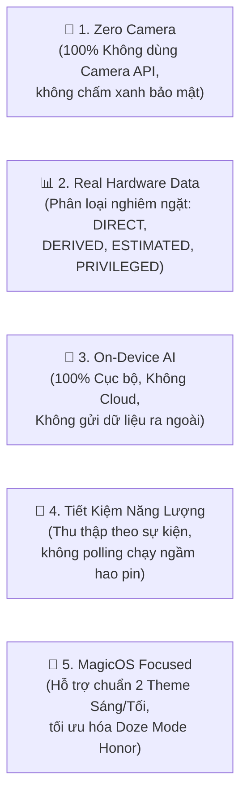
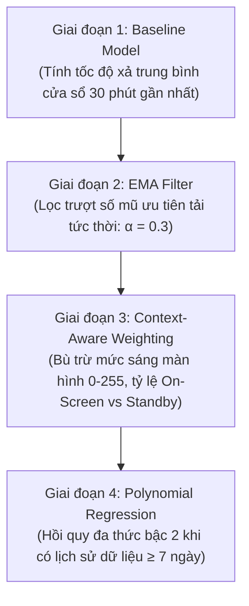

# 🔋 KẾ HOẠCH KỸ THUẬT TỔNG THỂ: TP HONOR OPTIMIZER — PHIÊN BẢN V2.0
> **Tên dự án:** TP Honor Battery & Performance Optimizer  
> **Tên ứng dụng:** TP Honor Optimizer  
> **Package Name:** `vn.tphonor.optimizer`  
> **Nền tảng mục tiêu:** Android 8.0 trở lên (`minSdk = 26`, `compileSdk = 35`, `targetSdk = 35`)  
> **Nền tảng ưu tiên:** HONOR MagicOS 7.x, 8.x, 9.x, 10.x+  
> **Ngôn ngữ & Giao diện:** Kotlin 2.x · Jetpack Compose · Material 3 · Room Database · DataStore  
> **Phiên bản tài liệu:** V2.0 (Kiến trúc sư phần mềm Android phê duyệt)

---

## 1. TỔNG QUAN DỰ ÁN & BỐI CẢNH KỸ THUẬT

### 1.1. Bối cảnh & Lý do Tái Cấu Trúc (Why V2.0?)
Trong phiên bản phác thảo ban đầu (V1.0), một số giả định kỹ thuật chưa phản ánh chính xác các giới hạn của Android Framework và quyền hạn của ứng dụng bên thứ ba (Third-party App):
1. **Sai lệch về công suất sạc:** Giả định lấy dòng điện $I_{bat}$ nhân điện áp $U_{bat}$ để tuyên bố củ sạc đang chạy ở mức 66W/100W Honor SuperCharge. *Thực tế:* Đây là công suất phía sau chuyển đổi PMIC nạp vào cell pin ($P_{bat}$), không phải công suất đầu vào cổng USB-C ($P_{bus}$).
2. **Ảo tưởng về quyền kiểm soát sạc phần cứng:** Giả định ứng dụng có thể tự động ngắt dòng sạc ở mức 80% trên mọi máy. *Thực tế:* Android không có public API để can thiệp ngắt mạch sạc vật lý nếu không có quyền Root hoặc Kernel Driver của nhà sản xuất.
3. **Giới hạn của `UsageStatsManager`:** Giả định đọc được CPU time, wakelock và năng lượng tiêu thụ của từng ứng dụng. *Thực tế:* Quyền `PACKAGE_USAGE_STATS` chỉ cung cấp thời gian chạy foreground và standby bucket; để đọc CPU time và wakelock chi tiết bắt buộc phải có `BATTERY_STATS` hoặc Shizuku/ADB.
4. **Đồng nhất sai nhiệt độ:** Giả định nhiệt độ pin là nhiệt độ CPU. *Thực tế:* Đây là 2 cảm biến vật lý độc lập.

**Phiên bản V2.0 sửa chữa triệt để mọi giả định sai lệch trên**, xây dựng một kế hoạch kỹ thuật trung thực, khả thi 100%, bảo vệ quyền riêng tư tuyệt đối, và tối ưu sâu cho người dùng HONOR MagicOS tại Việt Nam.

---

## 2. 5 NGUYÊN TẮC CỐT LÕI (CORE PRINCIPLES)

---

## 3. KIẾN TRÚC TOÁN HỌC & MÔ HÌNH THUẬT TOÁN (ALGORITHMIC MODELS)

### 3.1. Thuật toán Đo lường Công suất Sạc Phía Pin ($P_{bat}$)
* **Điện áp cell pin ($U_{bat}$):** Đọc từ `BatteryManager.EXTRA_VOLTAGE` ($mV \rightarrow V = \frac{U_{mV}}{1000}$).
* **Dòng điện tức thời ($I_{bat}$):** Đọc từ `BatteryManager.getIntProperty(BATTERY_PROPERTY_CURRENT_NOW)` ($\mu A \rightarrow mA = \frac{I_{\mu A}}{1000}$).
* **Xử lý tự động đảo quy ước dấu (Polarity Auto-Correction):**
  $$\text{Sign} = \begin{cases} +1 & \text{khi đang sạc (STATUS == CHARGING) và } I_{bat} > 0 \\ -1 & \text{khi đang sạc nhưng Driver trả về } I_{bat} < 0 \text{ (Tự đảo dấu)} \\ -1 & \text{khi đang xả (STATUS == DISCHARGING)} \end{cases}$$
* **Công suất nạp vào cell pin:**
  $$P_{bat} = U_{bat} \times I_{bat} \quad (W)$$
  * *Phân loại nhãn giao diện:*
    * $P_{bat} < 10W$: **Sạc Tiêu Chuẩn** (Standard Charging).
    * $10W \le P_{bat} < 25W$: **Sạc Nhanh** (Fast Charging).
    * $P_{bat} \ge 25W$: **Sạc Siêu Tốc Phía Pin** (High Power Battery Inflow).

---

### 3.2. Mô hình AI Dự đoán Thời lượng Pin (Multi-Stage AI Predictor)

Thay vì áp đặt một mô hình tĩnh, hệ thống áp dụng cơ chế dự đoán thích ứng 4 giai đoạn:

* **Công thức EMA (Exponential Moving Average):**
  $$R_{EMA}(t) = \alpha \cdot R_{instant}(t) + (1 - \alpha) \cdot R_{EMA}(t-1) \quad (\text{với } \alpha = 0.3)$$
* **Hệ số ngữ cảnh (Context Factor):**
  $$\text{Rate}_{adjusted} = R_{EMA} \times \left(1 + 0.3 \cdot \frac{\text{Brightness}}{255}\right) \times \left(1 + 0.1 \cdot \text{ThermalStatus}\right)$$
* **Ước tính thời gian cạn pin:**
  $$T_{remaining} = \frac{\text{CurrentLevel}}{\text{Rate}_{adjusted}} \quad (\text{Giờ})$$
  * Đi kèm khoảng tin cậy: $[T_{remaining} - \Delta t, T_{remaining} + \Delta t]$ với $\Delta t = \pm 15 - 25$ phút.

---

### 3.3. Thuật toán Ước tính Sức khỏe Pin (Coulomb Counter Health Estimation)
* **Nguyên lý:** Tích phân dòng điện nạp theo thời gian trong một phiên sạc sâu ($\Delta \text{Level} \ge 50\%$):
  $$Q_{in\_session} = \sum_{k=1}^{n} I_{avg}(k) \times \Delta t_k \quad (mAh)$$
* **Dung lượng sạc đầy ước tính ($Q_{full\_est}$):**
  $$Q_{full\_est} = \frac{Q_{in\_session}}{\text{Level}_{end} - \text{Level}_{start}} \times 100$$
* **Điều kiện phiên sạc hợp lệ:**
  1. Phiên sạc bắt đầu từ mức pin $\le 20\%$ và đạt $\ge 80\%$.
  2. Không bị ngắt quãng giữa chừng.
  3. Nhiệt độ pin không vượt quá $45^\circ C$ trong suốt quá trình.
* **Tỷ lệ sức khỏe pin (Health %):**
  $$\text{Health} = \frac{\overline{Q_{full\_est}}}{Q_{design}} \times 100\% \quad (\text{với } \overline{Q_{full\_est}} \text{ là trung bình của tối thiểu 5 phiên hợp lệ})$$

---

### 3.4. Thuật toán Chấm điểm Rủi ro Ngốn Pin của Ứng dụng (Drain Score Heuristic)
Do ứng dụng bên thứ ba không có quyền `BATTERY_STATS` trong chế độ thường, thuật toán chấm điểm rủi ro (Drain Score $0 - 100$) được xây dựng dựa trên các quan sát trực tiếp:
$$\text{DrainScore} = 40 \cdot \left(\frac{T_{fg}}{T_{total\_screen}}\right) + 30 \cdot \text{StandbyPenalty} + 30 \cdot \text{CatalogWeight}$$
* $\frac{T_{fg}}{T_{total\_screen}}$: Tỷ lệ thời gian chạy foreground so với tổng thời gian sáng màn hình.
* $\text{StandbyPenalty}$: Nhận $30$ điểm nếu app nằm ở `STANDBY_BUCKET_ACTIVE` hoặc `WORKING_SET` dù người dùng ít khi tương tác.
* $\text{CatalogWeight}$: Nhận $30$ điểm tối đa nếu package nằm trong danh mục **Honor Safe Debloat Catalog** (các dịch vụ rác nội địa Trung Quốc như Baidu, Honor Mall...).

---

## 4. BỘ TÀI LIỆU KỸ THUẬT BỔ TRỢ ĐÍNH KÈM

Bộ tài liệu kỹ thuật V2.0 được cấu trúc thành các tài liệu chuyên biệt phục vụ triển khai:

| Tên tài liệu | Đường dẫn tệp | Mô tả nội dung chi tiết |
|---|---|---|
| **Feature Feasibility** | [FEATURE_FEASIBILITY.md](file:///home/dcs/Desktop/Honor-Optimization-Toolkit/docs/v2/FEATURE_FEASIBILITY.md) | Ma trận kiểm toán tính khả thi chi tiết của 32 tính năng; phân loại DIRECT, DERIVED, ESTIMATED, PRIVILEGED, UNAVAILABLE |
| **Android Compatibility** | [ANDROID_COMPATIBILITY.md](file:///home/dcs/Desktop/Honor-Optimization-Toolkit/docs/v2/ANDROID_COMPATIBILITY.md) | Ma trận tương thích Android từ API 26 đến API 36; phân tích sâu hành vi PowerGenie của MagicOS China vs Global |
| **Architecture** | [ARCHITECTURE.md](file:///home/dcs/Desktop/Honor-Optimization-Toolkit/docs/v2/ARCHITECTURE.md) | Kiến trúc Clean Architecture, sơ đồ luồng dữ liệu một chiều (UDF), cấu trúc package chi tiết |
| **Database Design** | [DATABASE_DESIGN.md](file:///home/dcs/Desktop/Honor-Optimization-Toolkit/docs/v2/DATABASE_DESIGN.md) | Thiết kế Room Database (4 thực thể), sơ đồ ERD, thiết kế DataStore và chiến lược nén dữ liệu Downsampling |
| **Privacy & Permissions** | [PRIVACY_AND_PERMISSIONS.md](file:///home/dcs/Desktop/Honor-Optimization-Toolkit/docs/v2/PRIVACY_AND_PERMISSIONS.md) | Cam kết Zero-Network, Zero-Camera, mô hình bảo mật Chế độ Nâng cao Shizuku và quyền sở hữu dữ liệu người dùng |
| **Implementation Roadmap** | [IMPLEMENTATION_ROADMAP.md](file:///home/dcs/Desktop/Honor-Optimization-Toolkit/docs/v2/IMPLEMENTATION_ROADMAP.md) | Lộ trình chia làm 5 phiên bản (V1.0 đến V2.0) kèm tiêu chí nghiệm thu (Acceptance Criteria) khép kín |

---

## 5. HỆ THỐNG GIAO DIỆN MAGICOS (DESIGN SYSTEM)

### 5.1. Hai Theme Màu Hoàn Chỉnh

#### ☀️ Giao diện Sáng (Porcelain Light Theme)
* **Canvas Nền:** Trắng sứ Bắc Âu `#F6F8FB` (dịu mắt, có chiều sâu).
* **Thẻ Card:** Trắng tinh `#FFFFFF` với bo góc mềm đặc trưng Honor (`22.dp`), viền siêu mỏng micro-border `#E2E8F0` và đổ bóng nhẹ.
* **Chữ Chính (Primary Text):** Đen than chì Slate `#0F172A` (tương phản cao, cực kỳ sắc nét).
* **Chữ Phụ (Secondary Text):** Xám lạnh Cool Gray `#64748B`.

#### 🌙 Giao diện Tối (OLED Deep Slate Theme)
* **Canvas Nền:** Đen sâu OLED `#0A0D14` (tiết kiệm pin tối đa cho màn hình AMOLED/OLED).
* **Thẻ Card:** Xám than Elevated `#1B212E`, viền xanh Magic Blue `#0A59F7` và Magic Cyan `#00B4D8`.
* **Chữ Chính (Primary Text):** Trắng sáng `#FFFFFF`.
* **Chữ Phụ (Secondary Text):** Xám bạc `#94A3B8`.

### 5.2. Các Thành Phần Giao Diện Đặc Trưng
* **Magic Capsule (Dynamic Status Pill):** Viên nang nổi ở đỉnh hiển thị trạng thái sạc nhanh (Công suất W, Nhiệt độ, % pin).
* **Battery Gauge:** Vòng tròn năng lượng neon hiển thị mức pin và nhãn trạng thái thời gian thực.
* **Watt Meter Arc:** Cung tròn tốc độ sạc thể hiện công suất W biến thiên mượt mà bằng Canvas Compose.
* **100% SVG Vector Drawables:** Tất cả biểu tượng sử dụng Android VectorDrawable XML sắc nét, không dùng ảnh raster mờ.

---

## 6. KẾ HOẠCH KIỂM THỬ & BẢO ĐẢM CHẤT LƯỢNG (QA & TESTING)

1. **Unit Tests (Kiểm thử đơn vị):**
   * Kiểm thử tính toán công suất $P = U \times I$ với các tổ hợp dấu dòng điện khác nhau.
   * Kiểm thử mô hình hồi quy EMA với các chuỗi dữ liệu giả định trong môi trường test.
   * Kiểm thử thuật toán Coulomb Counter với các mức dung lượng pin khác nhau.
2. **Edge-case Tests (Kiểm thử tình huống biên):**
   * Thiết bị không hỗ trợ `CURRENT_NOW` (trả về 0 hoặc ngoại lệ) $\rightarrow$ Kiểm tra cơ chế Fallback.
   * Xoay màn hình trong khi đang sạc $\rightarrow$ Kiểm tra biểu đồ Canvas không bị vẽ lại từ đầu hay mất dữ liệu.
   * Cắm/rút sạc liên tục $\rightarrow$ Kiểm tra `ChargingSessionManager` không bị tạo rác session rỗng.
3. **MagicOS Real Device Verification (Kiểm thử thực tế):**
   * Kiểm thử trên thiết bị HONOR MagicOS nội địa để xác nhận thông báo cảnh báo 80% nổ chuông chuẩn xác.
